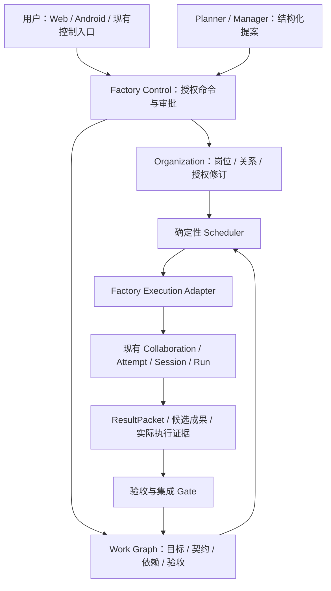
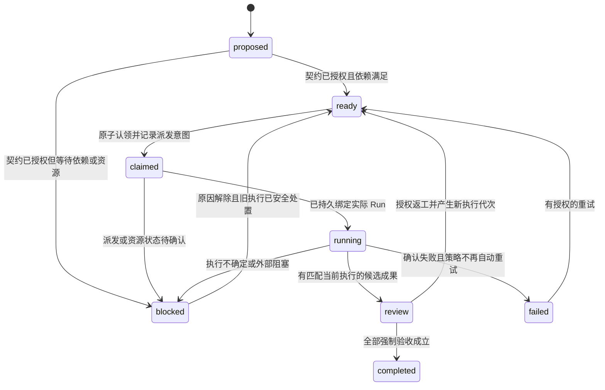

# Ragent Factory Runtime 总体方案

后续缺口与验收顺序见 [剩余工作与验收清单](remaining-work.zh.md)。

2026-11-14 补充：隔离基础服务已启动，授权 Linux 开发实例已完成真实组织规划及部分只读观察；目标、工作流及执行尚无真实端到端验收。咨询、受限授权修订和有界备份来源观察已有源码，GitHub Release 适配亦已提交；真实咨询、备份恢复和发布尚未验收。当前逐阶段缺功能和证据边界以实施状态为准。
后续源码允许 owner 发起受限单 reviewer 初始组织与首个只读报告，并为 Linux 共享 Codex 增加显式 opt-in 只读协商；这不等于通用团队创建或 Factory 端到端验收已通过；真实 Android 审查 Run 的 provider 报告只读，但旧 ResultPacket 摘要为空且未形成候选。预算预留不等于费用硬上限。
版本：2026-11-13 / v1。状态：基于源码核查修订的实施设计；部分源码已落地，缺项、现有检查和真实环境证据分别见 [实施状态](implementation-status.zh.md)，不以代码存在表示验收完成。

源码基线：`G:/Ragent/Ragent_product`，`main`，核查时 HEAD 为 `3628b2ef5f5627fe2118bda40691150c8d1da74f`。工作树存在其他任务的未提交修改，本方案以核查时读取的文件为准，不代表该提交或已发布安装包单独具备全部能力。

## 1. 目标与阅读入口

将 Ragent 已有的持久协作与组织运行时，演进为可以持续接收目标、调度任务、提交成果并接受用户指挥的工程团队运行时。

用户组建团队、授权目标与资源后，可以关闭客户端；服务器仍按已授权任务继续工作。服务器重启后，组织、任务、成果及审批仍可恢复，但执行是否可以继续必须根据实际进程、执行环境和副作用状态判断。关机期间不会继续计算，也不承诺所有 Harness 原地恢复。

核心身份分离：长期岗位负责职责与权限；Work Item 负责具体契约；Execution Binding 关联一次派发；现有 Attempt / Run 记录实际执行。任务跨会话存在，执行成功不自动等于任务验收完成。

| 文档 | 内容 |
| --- | --- |
| [现状与证据索引](current-state-evidence.zh.md) | 代码位置、已存在能力、静态发现、未验证范围及源码指纹 |
| [阶段 0：现状收敛与前置修复](phase-0-baseline.zh.md) | 已有链路缺口、权限和平台能力、兼容边界 |
| [阶段 1：持久工作图](phase-1-work-graph.zh.md) | 权威模型、命令、状态转换、迁移模式 |
| [阶段 2：安全执行闭环](phase-2-execution.zh.md) | 调度、租约、旧链适配、成果验收、恢复 |
| [阶段 3：团队指挥与客户端](phase-3-team-control.zh.md) | 持久岗位、消息、干预、组织修订、Web / Android |
| [阶段 4：工作流与交付](phase-4-delivery.zh.md) | 模板、审查、受控集成、候选产物与发布 |
| [阶段 5：迁移与真实验收](phase-5-rollout.zh.md) | 灰度、跨平台能力声明、恢复证据与退出旧路径 |

各阶段是依赖顺序，不是已获执行授权的任务清单。当前交付仅为方案文档；未修改运行代码、开启功能、运行测试或部署服务。

## 2. 根据真实代码调整原方案

### 2.1 已经具备的基础

1. **Collaboration 已经持久化。** SQLite 保存计划、任务、Attempt、派发命令和事件；有请求幂等、轮询对账与迟到成功修复。限制在于它仍围绕某次冻结计划及其汇总生命周期组织工作，不是“只有聊天、没有任务持久化”。
2. **Organization 已经有长期事实。** 节点稳定键、Revision、Freeze、Grant、角色实例、会话绑定代次、结构化操作日志、增量重规划及启动恢复均有实现。需要扩展生命周期和入口，不能重新设计一套不兼容的岗位系统。
3. **预算与内部消息不是空白。** 已有带代次和租约的 Typed Envelope、预算预留/结算/释放、停滞动作及角色上下文投影。
4. **Web 与 Android 已有组织展示代码。** Web 使用 Organization Projection v2；Android 有独立 organization 模块、DTO、Repository、ViewModel 和组织画布。仍需确认实际接线及接口一致性，不能把源码存在写成真机可用。
5. **已有统一 Orchestration 账本。** Execution / Step / Command / Interrupt 可复用；现有 Collaboration 将部分信息镜像到账本，并把镜像作为恢复/读取材料。新增 Factory 不能再创建第三套互相竞争的任务终态。
6. **已有 ResultPacket、阶段 Gate、工作区和受控写入机制。** 这些机制是基础，不代表完整的审查、集成与发布流水线已经完成。

### 2.2 必须修正的原判断

| 原方案中的暗含前提 | 核查后的决定 |
| --- | --- |
| 先修“单任务不支持” | 当前编译器、自然语言入口已接受一个任务，阶段派发也生成单任务计划；不列为已确认缺陷，仅保留现有兼容检查 |
| 权限传播一定仍有旧问题 | 已有签名能力传播及相应检查文件，缺少当前真实 Harness 运行证据；列为接线核查，不预判失败 |
| Organization Graph 从树直接变任意图 | 当前 Planner 强制 MANAGES 单父无环树；保留管理树，分类型增加 REVIEWS / CONSULTS，不能把工作依赖或审查链伪装成管理链 |
| WorkspaceLease 已保证 Run 全程单写 | 当前 Run admission 已切换为 mutation 级短锁；旧 Run 级恢复函数仍存在，但当前启动恢复调用的是 mutation 级回收 |
| Managed Writer 等于审查后合并 | 现有完成回调会把 staging 改动应用到 canonical，然后生成结果；Factory 必须改为候选成果先冻结、后验收、再集成 |
| 返工 lineage 已完全持久化 | `reworkContext` 仍由内存 Map 保存并在完成时读取；需先持久化返工所属组织、阶段和父 Packet |
| 只读审查可在三平台等价运行 | 内置认证路径依赖 Linux + bubblewrap；Windows / macOS 本地认证能力不能凭角色名或 Prompt 声称成立 |
| 组织开关关闭就一定完全不可用 | 原始配置回退值与语义能力函数的“未显式配置”兼容逻辑不同；安装包又有显式配置。以实际实例能力及拒绝路径为准 |
| Gate 有 evidenceRef 就是真实验证 | 现有 Gate 主要检查状态和证据引用存在；新增验收必须校验来源、内容版本、执行结果及授权 |

详细证据及置信边界见证据索引 E01–E18。

## 3. 范围和架构决策

### 3.1 第一版范围

- 单实例、单权威调度者，先支持一个工程团队对应一个项目；保留多个长期目标和任务。
- 复用现有 Session、Run、Harness Adapter、远程连接、认证及审批链。
- 保留现有共享后端 broker；任务用会话/线程、工作区、授权与版本身份区分，不要求每项工作启动独立 OS 进程或通用沙箱。
- 增加持久 Work Graph，并经兼容适配器使用现有 Collaboration 派发能力。
- 确定性的依赖推进、容量约束、重试、结果收集和验收；Manager 只在规划、阻塞和技术决策时参与。
- Writer 使用隔离候选工作区；一个集成入口负责修改目标分支。没有可验证隔离的环境，不开放无人值守并行写。
- 最早可用版本已经包含基本控制、验收和恢复，不能以“这些留到以后”为由先自动写回主工作区。

### 3.2 暂不做

多主数据库、跨实例一致性调度、Kafka / Kubernetes、任意多父管理结构、自发无限扩编、通用模板市场、让模型管理数据库、自动提升权限，以及默认生产发布。不接入 Gas City 等外部框架作为前置依赖。原文的外部产品类比不作为本仓库实现证据。

### 3.3 四层职责

图中的层是职责边界，不要求拆服务。新增 `work-graph`、`factory-control`、`factory-scheduler`、`factory-execution-adapter` 是建议模块名，均非当前 API。代码可按规模进一步拆文件；不再建一个拥有全部状态的巨型 Orchestrator。

## 4. 状态权威与存储边界

| 事实 | 权威写入者 | 其他模块的权限 |
| --- | --- | --- |
| 组织节点、关系、Grant、Revision、绑定代次 | 现有 Organization 领域命令 | 提案、读取或发送命令 |
| 目标、任务契约、依赖、负责人、任务验收终态 | Work Graph 领域命令 | Scheduler / Adapter 只能请求合法转换 |
| 某次具体派发、Attempt、旧计划内执行状态 | 现有 Collaboration Store | 不直接改 Factory Work Item |
| Run 进程和执行终态 | 现有 Run / Session 执行链 | 读取、受控取消与 steering |
| 不可变成果包及内容摘要 | ResultPacket Store | 引用，不能就地改包 |
| 资源 mutation 锁 | WorkspaceLease / MutationCoordinator | 不把短锁当 Run 排他授权 |
| 组织预算、预留和结算 | Organization Governor 扩展 | 不另立一套可绕过的计费事实 |
| 操作恢复日志与可观测 Execution | Organization Operations / Orchestration Ledger | 不竞争业务验收终态 |
| 用户/Agent 消息与已读状态 | Typed Envelope 及引用的消息记录 | 消息 ack 不代表任务命令已执行 |

“唯一写入者”指唯一领域协议与合法转换入口，不是要求只有一个函数或数据库连接。数据库事务与 CAS 仍是并发正确性的基础，进程内队列不足以替代它们。

建议 Work Graph 的新增表放在现有 `collaborations.sqlite`，以便任务变更、派发意图、组织关联在同一数据库事务中提交。**同一个文件不等于多个 API 调用自动原子化**：必须提供同连接事务入口，事务内不调用 LLM、创建进程或复制工作区。

现有 ResultPacket 位于 `project-workflow.db`，WorkspaceLease 位于 `runtime-coordination.db`，Run 还有独立持久化记录。因此只保证各域本地事务；跨域使用持久操作日志、稳定幂等键、结果查询与对账，不声称跨库 exactly-once。没有可查询/幂等能力的外部副作用，结果未知时停止自动重放。

## 5. 核心数据模型

以下为目标协议，不是已实现表结构。阶段 1 冻结字段、约束及迁移设计后再编码。

### 5.1 目标、岗位和任务

| 对象 | 必需信息 | 约束 |
| --- | --- | --- |
| Goal | id、projectId、organizationId、目标正文、验收基线、revision、授权主体、状态 | 初版目标列表 + 可选 parentGoalId；目标总体验收改变必须有授权修订，不先做独立复杂 Goal-DAG 引擎 |
| Position | 复用 nodeId / stableKey、职责、角色、能力需求、运行偏好、Grant、绑定历史 | 岗位不随 Session 删除；现有 role_instance / agent_id 的变化须保留历史 |
| Work Item | id、goalId、organizationId、projectId、kind、state、priority、assigneeNodeId、contractRevision、rowVersion、executionEpoch | 不以 sessionId 或 Collaboration id 作为任务身份 |
| Work Contract | objective、acceptanceCriteria、输入成果引用、允许路径、运行要求、预算/重试策略、组织修订和授权摘要 | 每版不可变；执行绑定固定某一版，优先级等调度属性与契约版本分离 |
| Dependency | predecessor、successor、requiredMilestone、版本约束、图版本 | 同项目无环；不能靠删除阻塞边静默放宽验收 |
| Execution Binding | workItemId、contractRevision、executionEpoch、bindingGeneration、collaborationId、taskId、attemptId、runId、幂等键、状态 | 同一 Work Item 初版仅一个活动执行；未收到 runId 时保留派发中状态 |
| Candidate Artifact | workItemId、执行关联、baseCommit、candidateCommit 或 patch digest、产物清单及 digest、隔离位置、保留状态 | 结果固定后不可由旧执行继续修改；重试不覆盖旧候选 |
| Acceptance Decision | criterionId、契约版、候选摘要、证据引用、审查主体、结论、generation、授权信息 | 证据不匹配时不能通过；Agent 文本仅作意见 |
| Control Operation | commandId、actor、目标、expectedVersion、idempotencyKey、payloadDigest、审批关联、执行状态 | 同键异内容拒绝；真实 actor 来自服务端认证，不采信请求自报 owner |

实现可采用 `factory_goals`、`factory_work_items`、`factory_work_contracts`、`factory_dependencies`、`factory_execution_bindings`、`factory_acceptance_decisions` 等加法表。操作日志优先扩展已有设施，不为同一次外部调用重复维护两个可消费 outbox。

### 5.2 三种版本不可混用

- `rowVersion`：并发更新某条任务时的 CAS，包括优先级和状态变动。
- `contractRevision`：目标、输入、范围、验收等实质工作契约的不可变版本。
- `executionEpoch`：重试、取消后替换或重新分派的执行隔离代次；旧代次不能提交新的有效验收或集成。

另有 `organizationRevision`、`bindingGeneration` 和 Gate generation，分别约束岗位授权、会话绑定和决策。不能用组织修订号充当全部 fencing token。

## 6. Work Item 状态机与里程碑

### 6.1 状态

上图省略通用控制边：非终态可请求暂停或取消。用独立 `controlState` 表示 `none / pause_requested / paused / cancel_requested`，避免把“请求收到”显示成“已经停止”。只有可确认旧执行停止或被有效隔离后，取消才进入终态 `cancelled`。不支持原地暂停的 Harness 使用停止后新 Attempt 继续；当前 Run 的实际终态仍由 Run 记录。

`completed` 与 `cancelled` 不就地重开；后续修复或目标变化创建关联任务。`failed` 可按明确授权重试。`blocked` 必须有结构化 reason、解除条件、关联 Operation / 资源和下一步责任者。

### 6.2 任务完成与交付里程碑

执行成功只允许提交候选并进入 `review`，不等于 Work Item `completed`。阶段 1 就定义验收协议，阶段 2 接通实际证据，不能把全部 Gate 推迟到阶段 4。

区分 `candidate_ready`、`accepted`、`integrated`、`released`。实现任务可以在成果被验收后完成，但发布任务必须显式依赖集成和候选包的 Gate。普通依赖默认要求 `accepted`；审查任务可显式依赖 `candidate_ready` 并绑定该候选摘要，避免“实现等审查、审查又等实现 completed”的死锁。

不同里程碑不使用一个含义模糊的完成百分比。UI 展示计数与状态；不能用 Token 消耗或消息数量伪造 58% 进度。

### 6.3 修改契约和依赖

每次变更先生成影响清单：受影响任务、活动执行、候选成果、审查与审批。允许无副作用的优先级更新直接 CAS；范围、验收、技术路线或强制前置变化要创建契约新版本。

运行中任务不得静默改约：选择旧版完成但不再采纳，或停止/隔离旧执行后重新派发。成果是否可复用必须形成新版本验收决定。涉及已完成任务时创建后续任务，保持历史真实。对候选内容、目标分支、验收契约的改动，应失效相应旧审批。

## 7. 调度与现有执行链适配

### 7.1 调度硬约束

依次检查：功能能力与实例状态 → 主体授权及组织修订 → 契约与依赖 → 有效绑定及无冲突执行 → 实际 Harness 能力 → 工作区隔离与磁盘容量 → 项目/组织/岗位/实例容量 → 预算预留。任一不满足均不能靠评分绕过。

第一版使用确定性的优先级、等待时间和稳定 ID 排序；并发名额与任务总数分开。恢复、审查、集成也需要容量，不应被所有 Writer 占满。暂不做模型推断的成本评分或学习型调度。

### 7.2 派发序列

1. 同事务 CAS 认领 Work Item，固定契约与 epoch，写 Execution Binding 和唯一派发意图。
2. 预留预算与隔离资源。外部资源通过可恢复 operation 分步建立，未完整准备时禁止启动。
3. Adapter 生成服务端受控单任务 Collaboration，持久保存准确 taskId 映射；不能依靠后续从标题猜关联。
4. 复用 Collaboration 的派发 outbox、requestId、Attempt / Run 绑定和恢复。外层意图只负责创建/找到该 Collaboration，不再次直接调用 `sendMessage`。
5. 新 Factory 路径需要显式禁用每项任务的额外 Manager aggregation；旧路径保持原语义。最终目标汇总是有预算的独立工作，不是每完成一个任务就再启动 Manager。
6. 实际 Run 绑定后才显示 running；未知响应先按稳定键查询，再决定是否补偿，不立即再开 Run。
7. 终态事件导入经唯一 inbox/event key 去重；结合契约版、epoch、binding generation、授权及候选完整性推进业务状态。

### 7.3 重试和恢复

分别处理暂时失败、确定性失败、等待用户、预算耗尽、能力不满足和 `unknown_outcome`。只有策略授权且确认不会重复副作用时自动重试；有界次数，计入组织累计预算。换模型也属于新执行，需要权限和运行能力重新检查。

启动恢复按事实逐项对账：未消费意图、已建 Collaboration 未回写、已存在 Run 未观察、结果已落盘未关联、验收已记录未投影、外部操作结果未知。Worker 活着就关联回原执行；不能确认存活或安全隔离则阻塞，不凭租约 TTL 重新放行冲突写入。

首次实现以现有启动恢复和 bounded reconciler 为基础，增加分页和游标，不能用 UI 的有限事件列表重建完整工作状态。

## 8. 写入、候选成果与集成

### 8.1 三类锁与边界

- 工作认领租约：调度所有权，可过期并重新对账，不能证明进程已死。
- 执行/工作区隔离：保证不同 Attempt 的实际修改对象独立，撤销后旧结果不能成为有效交付。
- mutation 锁：一次受控资源变更的短锁，复用现有协调器；必须保证有效期、版本检查与实际写入一致。

当前协调器传入 leases 后调用任意异步 mutate，没有自动中止超时回调；锁按精确 resource key 冲突，文件键与全工作区键不会天然互斥。因此 Factory 不能仅复用 API 名称就声称排他性成立。

最早可执行版为集成统一采用规范化后的同一项目/目标工作区集成键，并验证所有会改该目标的受控入口遵循它；细粒度锁优化以后再做。外部编辑器或未接入协调器的工具不受该锁保护，须通过目标版本检查拒绝冲突，不能宣称已经锁住外部写入。

### 8.2 候选先于 canonical 写入

Factory-owned 工作禁止沿用“Run 完成立即 commitStagingToCanonical”的默认链。增加显式执行归属/交付模式，旧任务保持旧行为，新任务在隔离区冻结候选，产出 commit/patch digest、基准、路径清单与证据。

Managed Writer 当前的 `commit` 是文件应用，不一定是 Git commit；不得据函数名认定已有 Git 合并流水线。复用其路径验证逻辑，并补上：基准版本校验、候选保留、失败恢复、审查关联、一次性集成授权。

Writer worktree 提供版本和目录隔离，但不是读取密钥、网络、执行命令的安全沙箱。敏感目录、工具权限和外部副作用仍需执行边界约束；无法强制的能力不授予。

### 8.3 审查与集成

Reviewer 只读查看固定候选和既有证据。QA 检查可以在候选的派生验证工作区产生构建缓存和输出，不因此获准修改候选源码或目标分支。最终集成检查当前目标 head 与被审查基准；目标变化则重新合并和评估受影响证据。

集成 operation 持久记录起始 head、候选摘要、结果 head 与审批，响应丢失时先查询实际仓库状态。逐文件 best-effort rollback 不能等价于跨进程事务，必须保留中断恢复信息。冲突进入 blocked，不由 Agent 静默选一边覆盖。

## 9. 验收、审批与权限

每个 acceptance criterion 使用稳定 ID，并指定证据类型、可信执行来源、适用契约版和候选摘要、必要的审查/审批主体。检查结果包括 `passed / failed / unknown / not_run`；缺证据不能提升为 passed。

可信证据来自已有业务检查、编译结果、真实产物、源代码差异及用户授权的人工验收。LLM 可以总结证据，但不能自行决定它提交的任意字符串就是真实运行记录。人工验收须记录其范围及未验证项，不能冒充测试通过。

权限按当前实例授权、组织 Grant、岗位能力、任务契约和执行环境能力取交集。管理关系不隐含生产部署权限；审查关系不隐含写权限；咨询关系不隐含读取其他任务的敏感资料。

Factory Control 统一接收来自用户和 Agent 的结构化命令。先读真实认证主体，再检查目标访问范围、expectedVersion、idempotencyKey、payload digest、组织/授权代次和必要审批。前端返回 `accepted` 只表示命令已持久接收；界面持续显示是否等待授权、停止确认或实际执行结果。

复用当前审批/Interrupt 设施，绑定准确操作、候选内容及目标，不新增一套平行审批。高风险发布按用户已有授权与现有风险策略执行，不因每个步骤都经过 Runtime 就额外增加人工确认。已授权范围内自主进行，只有超范围或显式 Gate 才等待用户。

## 10. 长期团队、直接指挥与知识连续性

### 10.1 岗位与组织

复用 organization_nodes 和 role_instances。首版保留单父 MANAGES 树，REVIEWS / CONSULTS 是附加关系，不参与管理继承；每种关系分别校验作用域、环路规则和独立性。审查人员可以审查多个岗位，不必成为其上级。

现有组织以唯一 rootSessionId 关联入口。迁移初期保留它作为兼容锚点，禁止清理仍被活跃 Factory 引用的根会话；阶段 3 新增以 organizationId 寻址的长期入口和 root 绑定历史。换聊天入口不删除组织、任务或预算。

Provisioning 现有策略会按冻结节点创建 Managed Session。创建空 Session 不等于启动付费 Run，因此无需为“省 Token”立即重写全部 provisioning；逐步按需生成或替换会话，模型切换采用绑定代次和可恢复替换操作。

### 10.2 消息与控制命令

普通问题、咨询、反馈走持久消息；暂停、取消、调优先级、换人和改约走命令。复用 Typed Envelope 的引用式载荷，不把自由文本塞进它明确禁止的 `payloadRef.body` 等字段；消息正文另存受限记录，再用 ID 引用。

不放开 Managed Input 的普通 sendMessage 绕过。用户面向岗位发言，由 Factory Control 转成授权输入或独立咨询任务。区分消息送达、Agent 已读取、请求已答复和任务已变更；仅必须答复的请求设置答复期限，避免每条消息都触发新 Run。

Steering 根据实际 runtime family 声明与运行确认选择：可即时 steering、停止后续接、仅下一轮输入。当前 Claude 双向协议描述的是 interrupt + next-turn，不能统一宣传为运行中无缝变更。取消请求未确认时继续占用相关容量/风险状态。

### 10.3 工作知识

复用 Organization Context Projection、ResultPacket、项目 checkpoint/handoff 与现有上下文编译器，增加任务交接记录：目标/契约版、关键决策及来源、输入输出成果、失败原因、已完成动作、未决问题、下一步和预算余额。

权威事实从 Store 重建；LLM 摘要作为有来源、可失效的派生资料。岗位共享记忆不自动扩散所有私聊内容与凭据。换模型时注入相同事实契约，不传递不兼容的 provider session 状态。

## 11. 预算、停滞与可观测性

扩展现有 Governor，明确累计额度与瞬时容量：组织/目标累计 tokens、cost、runs、retries、replans；实例/项目/岗位并发槽位独立计算。当前组织计数按 revision，新增组织总预算必须跨修订累计，避免换 Revision 重置花费上限。

预算先预留、后按后端实际 usage 结算；usage 未返回标为 pending，不填零。对不支持即时费用统计的 Harness，使用保守的运行次数、时间和可执行额度上限，显示成本估算及误差，不承诺严格美元上限。停止请求发出到停止确认之间的实际成本也要纳入记录。

只有结果提交、有效验收、阻塞解决或真实集成等事件计为进展；聊天和重复规划不计。停滞触发有界 retry / replace / replan / escalate，超预算进入等待处理。通知以有意义的状态变化为准，不每次调度循环发消息。

运行投影应能回答：为什么未派发、谁在执行、哪个命令尚未生效、等待哪个审批、使用哪版契约、成果和证据在哪里、当前成本是否完整。记录事件 cursor、asOf 和 schema version；断线重连可全量刷新并接续，不以缓存视图驱动调度。

## 12. Workflow Formula 与最终交付

模板是版本化的任务生成规则，编译成普通 Work Graph；不是另一个运行引擎。模板包括输入参数、角色要求、依赖里程碑、验收、预算和权限要求。模板不能授予高于调用者的权限，不能携带未审核的任意脚本副作用。

先交付一套来自实际项目的研发流程，再考虑 release-engineering / security-audit 等 Pack。模板实例固定版本，修改模板不改写运行中的任务。安全审查与发布流程沿用现有真实检查和授权，不默认新增测试基础设施。

交付链：候选代码 → 固定内容审查 → 已有可信检查 → 受控集成 → 集成结果必要验证 → 候选产物 → 明确发布授权 → 发布结果查询。包的 digest、构建来源、目标环境和审批必须一致。PR/Commit 是交付对象，不以 PR 创建或合并成功代替产品验收。

## 13. 迁移和回退

采用 `legacy / shadow / active` 三种明确归属。名称为设计约定，尚未实现。

1. legacy：原 Collaboration / Organization 路径保持原有权威。
2. shadow：只将旧任务投影到新模型检查映射，Factory Scheduler 不派发，不能写旧域完成状态。
3. active：只有显式 Factory-owned 新任务由新状态机调度，旧 Collaboration 作为单次执行适配器。

历史已完成记录作为历史证据导入，不自动补造新验收成功。运行中的旧 Collaboration 默认自然结束，不中途切换所有权；确需接管则先停派发、确认活动执行状态、保存精确映射并执行迁移事务。

所有 schema 为加法迁移，旧二进制能否忽略新记录必须逐项确认。关闭 Factory 调度开关只停止新准入，不自动取消 Run 或丢弃未知副作用；保留观察、恢复与用户取消通道。回退不删除新表，不把未验收候选自动写回主工作区。数据库和产物备份必须对应同一应用检查点，多库文件不能分别随意复制后宣称一致快照。

跨平台能力逐项发布：可查看/控制、可运行 Writer、可认证只读审查、可集成、可构建、可恢复。Windows/Android 控制 Linux 上的已验证团队可以是早期交付路径，但不能被表述为 Windows 本地认证只读已完成；部署到远端须有相应授权和实际能力接线。

## 14. 分阶段边界与完成条件

| 阶段 | 可交付结果 | 阶段退出条件 |
| --- | --- | --- |
| 0 | 准确现状、已确认缺口收敛、兼容和平台约束 | 阻断闭环的问题被解决或有明确禁用范围，不能只拿测试数量宣称完成 |
| 1 | 可独立持久化、修改和读取的工作图 | 契约、状态、版本、命令和 ownership 明确；默认不启动新执行 |
| 2 | 一个真实任务链可派发、提交、验收、恢复 | 不重复副作用、不抢跑依赖、不自动回写未验收成果；基本控制可用 |
| 3 | 用户能长期管理团队并准确干预 | Web/Android 对同一事实显示一致，指令有真实回执，岗位不依赖某次聊天生存 |
| 4 | 可复用流程与可审查交付候选 | 候选、审查、集成、包和发布授权形成可追溯链 |
| 5 | 可灰度发布的产品能力 | 实际目标平台与真实项目证据充分，未知项如实保留，回退路径可执行 |

阶段 0 与阶段 1 的设计可交叉推进，但执行准入必须等前置门槛成立。阶段 3 的 UI 规划可提前，不能用模拟进度代替阶段 2 的真实链路。不给出缺乏依据的日历工期；每阶段根据前一阶段实际发现再估算。

## 15. 验证与本次交付边界

遵守工作区 Evidence First：先实现，再审阅直接依赖和差异，必要时运行已有可信检查；不为展示进度创造测试脚本、模拟业务数据或预设成功结果。新增测试或测试基础设施须另行取得用户许可。所有阶段文档中的“退出证据”是产品条件，不是本次已执行测试，也不是默许添加测试。

已有测试文件只支持它们实际验证的协议范围。包含依赖注入、模拟 Harness 或构造数据的现有检查，即使通过，也不能证明真实 Codex/Claude、系统服务重启或 Android 真机链路已通过。

本次仅静态阅读源代码和既有检查、确认引用与文档一致性。未运行应用、未访问生产数据库、未调用付费 Harness、未测试重启、未安装包。历史执行记录仅作背景，不继承为本次证据。

Windows 本地所有后续源码副本、worktree、TEMP/TMP/TMPDIR、可变包缓存、构建输出、证据和测试实例必须位于 `G:/Ragent`。核查时 G: 可用约 7.7 GiB，文档足够；开始隔离执行或多平台构建前必须重新检查容量，不先复制整仓或下载运行时。保留并行工作和已安装服务，不以清理为由删除未提交改动。

下一步实施入口是阶段 0 的证据清单和阶段 1 的权威协议。总方案的成功标准是持久任务能够在真实执行、人工指挥、失败恢复与成果验收之间保持一致，而非增加 Agent 数量或制造更多会话。
