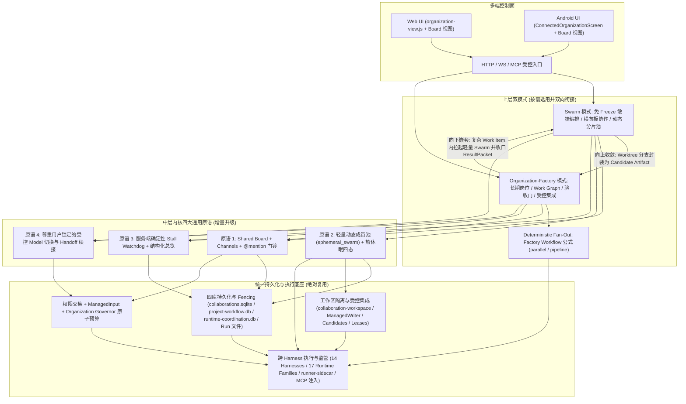
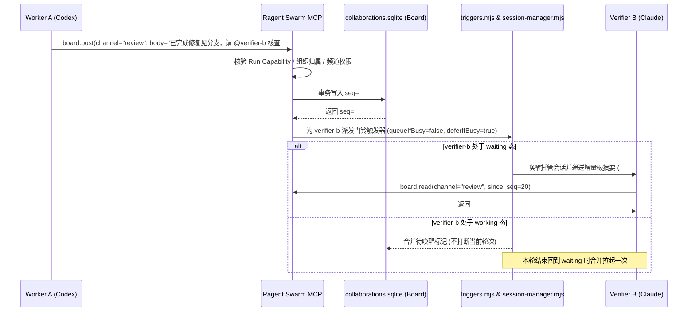
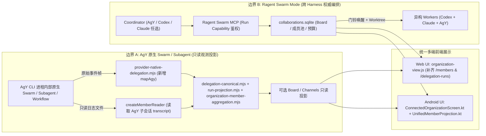

# Ragent 多 Agent 演进（Swarm 模式）与 AGY CLI 适配架构方案

- **日期**：2026-11-19
- **状态**：**架构分析与演进方案（设计稿，尚未开始编码实现，不代表任何新增能力已落地或通过验收）**
- **源码核查基线**：`main` @ `ca194121`（注：核查时工作树存在其他并发任务的未提交改动；本文仅依据核查时仓库已有源码与 `agy` CLI 公开文档及命令帮助界面形成结论，其中涉及新版 `agy acp` / `stream-json` 实时事件帧与原生 Swarm 行为的细节，须待阶段 0 实机协议采样后最终定稿，不以静态推断冒充运行时事实）
- **前置参考规范**：本文遵循仓库既有 Evidence First 文档边界，补充而非替代 [组织代理身份、运行时与恢复规划](organization-agent-runtime-plan.zh.md) 与 [Ragent Factory Runtime 总体方案](factory-runtime/00-master-plan.zh.md) 中已冻结的架构约束。

> **核心结论（TL;DR）**
> 1. **演进路线**：既不平行另起一套独立的 Swarm 运行时，也不把高频自由协作强行塞进重型的 Freeze-Revision / Phase-Gate 流程。推荐采用 **「统一底座 + 升级中层 4 原语 + 上层双模式（Swarm 模式 / Organization-Factory 模式）」**，让轻量动态群智协作与重型受控工程交付共享同一套 Harness 执行链、预算账本、权限交集、Worktree 隔离与多端控制面。
> 2. **中层内核升级**：围绕共享留言板与频道门铃（`Shared Board + Channels + @mention`）、免 Freeze 的轻量动态成员池与热休眠、服务端确定性 Stall Watchdog、以及尊重用户锁定的受控模型切换四项原语升级现有组织内核，对外暴露统一的跨 Harness Swarm MCP 工具契约与内置技能，打造 **跨 Harness 异构混编 Swarm** 差异化优势。
> 3. **`agy` CLI 深度适配**：将现有 `agy` 适配器从早期 one-shot `stream-json` 打印模式升级为全能力一等公民——解除版本上限与命名分裂，主推 `agy-acp`（并补齐 ACP 反向权限请求桥接）辅以长连接 `agy-stream-json-bidi`，打通 MCP 双向注入/透传与 Skill/Hooks 发现；对 AgY 原生 Swarm/Subagent 严格恪守 **「只读观测投影」与「Ragent 跨 Harness 编排」** 两条清晰边界，不越层接管 CLI 私有内部调度器。

---

## 1. 背景、问题定义与现状基线

### 1.1 行业多 Agent 协作范式演进

2026 年以来，主流编码 Agent 生态在多 Agent 编排方向呈现出三条代表性路线，各自瞄准了不同粒度的工程问题：

1. **Antigravity Native Swarm**：以极简共享留言板（Board + Channels）、`@mention` 门铃按需唤醒、零成本 `waiting` 休眠、一键分片池（`tasks[]`/`n`）与原地热上下文分叉（`fork`）为核心，强调零前期仪式感、高密度同行横向协作与对抗式验证（Adversarial Verifiers）。
2. **Claude Code Agent Teams**：围绕共享 Task Ledger、文件锁冲突防护、点对点邮箱通信、Git Worktree / Tmux 隔离会话与确定性 Lifecycle Hooks（如 `TeammateIdle`、`TaskCompleted`）展开，偏重受控分工与工具层钩子治理。
3. **代码驱动确定性 Fan-Out 与平台级子代理**（以 Antigravity `run_workflow` 与 Codex Multi-Agent 为代表）：当任务可被确定性地拆解为并行映射、流水线阶段或带结构化 Schema 校验的聚合（`parallel` / `pipeline` / `phase`）时，由宿主管线或轻量脚本直接编排多个独立 Agent 实例，避免把确定性循环浪费在自由对话协商上。

### 1.2 Ragent 现状基线

在讨论演进前，必须如实厘清当前 `main` @ `ca194121` 的代码与验收边界：

- **多 Agent 组织聊天（Organization Chat）**：根会话规划、主管动态追加节点、托管成员执行与自动根汇总的核心后端源码已存在，且截至提交 `e5689903` 完成了若干关键交付链修复；但截至本文核查时间点，**尚待完成修复后的完整真实业务端到端验收**，不能宣称已达到生产稳定态。
- **Factory Runtime 规划与后端模块**：[Ragent Factory Runtime 总体方案](factory-runtime/00-master-plan.zh.md) 已冻结四层职责与状态权威边界，Work Graph、Candidate Artifact、Controlled Integration、Task Handoff 与 Workflow 等大量后端模块源码已落盘，但默认准入开关保持关闭，且尚未完成全链路真实环境端到端验收。
- **`agy` CLI 适配器现状**：仓库已存在 `chat/adapters/agy.mjs`、`lib/agy-runtime.mjs`、`lib/agy-manager.mjs`、`lib/agy-auth.mjs`、`scripts/agy-runtime-launcher.mjs` 与账号轮换链路，但目前停留在早期 one-shot `--print=` + `stream-json` 阶段，在版本准入、多轮长连接、MCP 注入与透传、Skill/Hooks 发现以及原生 Swarm/Subagent 观测上存在明显断层。

### 1.3 本文聚焦解决的三个核心问题

1. **架构路线抉择**：面对 Swarm 协作范式的兴起，Ragent 应该在现有持久化组织底座上增量升级，还是平行另起一套全新的 Swarm 运行时？
2. **Ragent 多 Agent 内核演进**：Ragent 自身的多 Agent 体系应当吸收哪些经过验证的 Swarm 设计精华，同时牢牢守住哪些不可退让的工程护城河？
3. **`agy` CLI 一等公民适配**：如何在协议层、MCP 双向适配、Skill/Hooks 治理以及原生 Swarm 观测与跨 Harness 编排边界上，系统性地把 `agy` CLI 提升到与 Codex / Claude 对齐的一等接入水准？

---

## 2. 行业范式与 Ragent 现状深度对标

### 2.1 三大体系全景对标

| 对比维度 | Antigravity Native Swarm | Claude Code Agent Teams | Ragent 现有 Organization / Factory |
| --- | --- | --- | --- |
| **核心心智模型** | 共享留言板 + 角色分工的敏捷群智协作，即开即用 | 共享任务清单 + 点对点邮箱的团队并行编码 | 持久化工程组织树 + 契约化任务/阶段与不可变成果交付 |
| **拓扑与通信** | 网状自由横向通信；Board + Channels；`@name` / `@#channel` / `@all` 门铃；`#seq` 短引用 | Lead + Teammates；共享 Task Ledger 抢单/领单 + P2P 邮箱消息 | 严格单父管理树（`MANAGES`）；中心经主管/根收敛；横向关系仅建模未开 Agent 间发言工具 |
| **生命周期与唤醒成本** | `waiting` 零成本休眠，仅被 `@` 唤醒；支持 `tasks[]`/`n` 批量分片与 `fork:"member"` 热分叉 | 常驻队友会话 + Idle 钩子唤醒；通常按显式队友角色常驻 | 偏一次性 Collaboration / Phase 派发；有持久会话绑定代次，尚无零成本板门铃热续接 |
| **工作区隔离与集成** | `inherit` / `share`（工作树）/ `branch`（独立克隆）；依赖协调者手工合并后 `kill` | Git Worktree / Tmux 窗口 + 文件锁防撞；人工或 Lead 整合 | `chat/collaboration-workspace.mjs`（Worktree/Staging）+ `ManagedWriter` + Factory 不可变候选与受控集成（默认派发仍偏 `shared`） |
| **停滞与异常监测** | 独立 `monitor` 代理按定时器巡检并喊话；另配 `narrator` 输出人话总览 | 确定性 Lifecycle Hooks 拦截空闲与完成态 | 后台持久化 `reconcile()`、中断状态机、Typed Envelope 队列与升级链（尚缺 Swarm 级静默死锁门铃） |
| **跨 Harness 与多端能力** | 单厂商 Antigravity 内部生态；桌面/单端为主 | 单厂商 Claude Code 生态；终端/Tmux 为主 | **14 个 Harness / 17 个 Runtime Families 异构统一编排**；守护进程离线长跑 + Web & Android 实时遥控 |
| **治理、权限与验收边界** | 强依赖模型自觉遵守协议；无不可变候选与硬验收门；高配额消耗（Quota Heavy） | Hook 可做局部校验；缺乏跨库不可变证据链与统一多账户预算治理 | 四库持久化与多维 Fencing Token、服务端权限交集、`ManagedInput` 边界、不可变 `ResultPacket`、原子预算预留 |

### 2.2 Antigravity Swarm 的设计精华与客观短板

**值得 Ragent 精准吸收的设计精华**：

1. **极简四原语与零前置 Ceremony**：整个协作面收敛在 `swarm`（成员生命周期与分片）、`post_message`（发帖与门铃）、`read_board`（按游标增量读板）、`swarm_wait`（主动休眠等待唤醒）四类动作，协调者无需先填写冗长的 JSON 组织冻结提案即可在秒级拉起多角色并行攻坚。
2. **Board + Channels + `@mention` 门铃机制**：
   - 按功能域划分频道（例如 `#backend`、`#frontend`、`#qa`），`main` 频道严格收敛为跨区决策、接口契约与收口结论，避免全员上下文被实现噪音淹没；
   - **`@name`、`@#channel`、`@all` 是唯一的唤醒门铃**——普通发帖只追加记录，不触发未点名成员的新一轮推理，把闲置通信的 token 成本压到接近零。
3. **`#seq` 稳定序号引用**：每条板消息拥有单调递增序号，后续讨论、审查与复盘直接引用 `#42` 而非反复粘贴数百行上下文，显著降低长链路上下文膨胀。
4. **弹性池化与运行时韧性**：
   - `waiting` 态零 token 休眠，唤醒即热续接；
   - `tasks[]` / `n` 支持一条指令拉起同构分片工作池（如 `<name>-1` 至 `<name>-k`）；
   - `fork:"member"` 支持把已有上下文热分叉给新角色，免去重新摸排代码库的冷启动成本；
   - `workspace:"share"` / `"branch"` 把写隔离作为创建成员时的一等声明；
   - 当某成员触发配额或限流瓶颈时，支持在 `waiting` 态原地 `model` 切换，保留对话并继续未尽工作，而不是直接销毁重来。
5. **对抗式角色分离与可观测辅助**：天然鼓励将写者（Author）与对抗式验证者（Adversarial Verifier）物理拆分为独立上下文，避免自己查自己；引入 `monitor` 处理全员停滞，`narrator` 将技术流水转译为面向人类的高层进展总览。

**必须清醒认识的客观短板**：

- **单厂商生态锁定**：无法在一个团队里同时调动 Codex、Claude、Gemini/AgY 等异构 Harness 互补所长。
- **软约束强依赖模型自觉**：成员越权改文件、未合代码先退出、未做实测宣称完成等行为缺少服务端硬门禁兜底。
- **缺乏不可变候选与正式交付链**：适合探索与快速协同，但缺少不可变成果包（Candidate Artifact）、跨重启审计链与受控发布门。
- **Quota Heavy（显著的协调税）**：无硬预算预留、无跨会话成本归集；LLM 驱动的 `monitor` 与 `narrator` 在长任务中本身也会持续消耗可观额度。

### 2.3 Claude Code Agent Teams 与 `run_workflow` 的互补启示

- **Claude Code Agent Teams 的启示**：共享 Task Ledger + 文件锁机制证明，当多个写者协同推进一个 backlog 时，**结构化任务状态与文件所有权声明**比纯聊天板更不易撞车；同时 Lifecycle Hooks 证明了「确定性代码规则拦截特定生命周期节点」远比纯 Prompt 叮嘱可靠。
- **`run_workflow` 的启示**：当工作天然是确定性的批量扫描、多文件改造、独立 Bug 归类或阶段化管道（`parallel` / `pipeline` / `phase` + 结构化输出 Schema）时，用宿主管线/工作流公式做确定性 Fan-Out 与归约，比让一群 Agent 在聊天板上互相 `@` 效率高一个数量级，且完全可控。

### 2.4 Ragent 不可放弃的核心护城河

任何演进方案都必须建立在不破坏 Ragent 既有核心优势的前提之上：

1. **跨 Harness 异构统一编排**：`lib/harness-registry.mjs`、`chat/provider-contract.mjs` 与 `chat/process-runner.mjs` 统一封装了 **14 个 Harness / 17 个 Runtime Families**，这是任何单厂商内置 Swarm 都无法提供的平台级能力。
2. **四库持久化边界与多维 Fencing Tokens**：
   - `collaborations.sqlite`（组织、节点、关系、计划、任务、派发与操作日志）、`project-workflow.db`（不可变 `ResultPacket`）、`runtime-coordination.db`（资源锁与运行时协调）以及独立的 Run/Session 持久化记录分工清晰；
   - 以 `revision`、`contractRevision`、`executionEpoch`、`bindingGeneration`、`rowVersion` 构成的多维 Fencing 机制，确保迟到结果不会覆盖新代次执行，也不复活已取消任务。
3. **真实隔离与受控集成链路**：`chat/collaboration-workspace.mjs`（Worktree/Staging 工作区）、`chat/managed-writer.mjs`、`chat/factory-candidates.mjs`（候选产物冻结）、`chat/factory-integration.mjs`（单入口受控 Git 集成）、`chat/workspace-leases.mjs` 与 `chat/mutation-coordinator.mjs` 共同构成了可审计的并发写入防线。
4. **不可变成果与真实证据核验**：`chat/result-packets.mjs` 强制区分成员自述与服务端可核验证据引用，拒绝“口头宣称完成”。
5. **服务端权限交集与 `ManagedInput` 边界**：`chat/managed-input.mjs` 与 `chat/organization-role-contract.mjs` 确保节点权限由父子策略与服务端能力做严格交集，提示词和技能文本本身永远不授予权限。
6. **原子预算治理、后台守护长跑与多端遥控**：`chat/organization-governor.mjs` 提供预算预留/结算/释放；`chat/runner-sidecar.mjs` 支持客户端离线后服务端持续托管运行与进程监管；Web 与 Android 客户端可随时跨端查看与干预。

### 2.5 剖析 Ragent 当前的 5 个真实痛点

对照行业敏捷协作体验，核查 `main` @ `ca194121` 源码可以明确看到 5 个制约日常易用性的真实瓶颈：

1. **前期仪式偏重**：一次标准组织协作需要走 `plan.submit → freezeRevision → provision → phase.dispatch → ResultPacket → 根汇总` 的重型状态流转；对于探索性问题排查、并行多视角代码审查或 2–4 个 Agent 的快速结对攻坚，起手门槛过高。
2. **严格单父树与中心通信瓶颈**：
   - `chat/organization-control-tools.mjs` 当前缺乏 Agent 间直接横向发言工具；
   - 虽然 `organization_team_relations` 已支持将 `REVIEWS` / `CONSULTS` 建模为非管理关系边，但实际执行中同级成员无法直接通过共享板对话碰撞；
   - `chat/organization-messaging.mjs` 明确将 `internal_envelopes` 限定为系统引用通知，在 `validatePayloadRef()` 中硬性禁止携带 `content` / `text` / `body` / `message` / `prompt` 等正文键；
   - `chat/organization-team-messages.mjs` 仅面向 Owner → Node 方向，不提供 Agent → Agent 的结构化横向讨论面。
3. **偏一次性 Collaboration，缺少常驻休眠与热分叉**：成员完成阶段任务后往往即归档收敛，缺少「零成本 `waiting` 驻留 + `@mention` 门铃热续接 + 基于受控上下文的 `forkFrom` 分叉」的弹性体验。
4. **默认工作区体验不够顺手**：`chat/organization-phase-dispatch.mjs` 默认仍偏向 `shared` 工作区模式，虽然底座已有 Worktree/Staging 能力，但“创建写者即一键声明独立 Worktree，收口再合并”的轻量化路径尚未打磨成默认直觉。
5. **Web 与 Android 展示能力不对齐**：Android 侧已在 `android/feature/organization`（`ConnectedOrganizationScreen.kt` + `UnifiedMemberProjection.kt`）接入统一成员投影与原生委派视图；而 Web 侧 `static/chat/organization-view.js` 目前仅拉取 `/api/sessions/:id/organization/projection?version=2`，尚未接入 `/api/sessions/:id/organization/members` 与 `/api/sessions/:id/delegation-runs`，导致 Web 看不到完整统一成员与 Provider 原生子代理状态。

---

## 3. 核心决策分析：升级现有底座 vs 平行另起一套

### 3.1 三条候选路线对比评估

#### 路线 A：平行另起一套独立的 Swarm 引擎（否决）

表面上另建一套轻量化 `swarm-store.sqlite` + 独立进程拉起器似乎可以“快速出活”，但在 Ragent 架构下会立刻引发 **5 大架构灾难**：

1. **公然违背「禁止竞争任务终态」的总体原则**：[Ragent Factory Runtime 总体方案](factory-runtime/00-master-plan.zh.md) 明确规定不得再建第三套互相竞争的业务状态与终态账本；平行引擎会立刻把同一项目的组织、成员和执行记录撕裂为互不感知的两套世界。
2. **双预算账本导致成本失控**：平行引擎绕开 `chat/organization-governor.mjs` 的原子预留与结算后，无法对同一用户/项目实施统一的并发额度防线。
3. **双进程、取消与恢复链引发孤儿进程**：`chat/runner-sidecar.mjs`、`chat/process-runner.mjs` 与 `chat/session-manager.mjs` 已经沉淀了跨平台信号终止、崩溃对账、停滞检测和重启恢复逻辑；重造一套只会引入难以排查的僵尸进程与取消失效。
4. **`WorkspaceLease` 与文件写入冲突**：独立 Swarm 若不经过 `chat/workspace-leases.mjs` 与 `chat/mutation-coordinator.mjs` 直接操作同一仓库，将与正在进行的常规会话或 Factory 任务发生静默覆盖与 Git 锁冲突。
5. **Web 与 Android 双重 UI 割裂**：两端不得不同时维护「组织/Factory 视图」与「Swarm 视图」两套 API、两套状态机和两套推送通道，长期维护成本成倍放大。

#### 路线 B：将 Swarm 硬塞进现有 Freeze-Revision / Phase-Gate 流程（否决）

强行要求每次拉起一个临时排查成员或发一条横向讨论都必须走提案提交、版本冻结、阶段门禁与根汇总，会彻底抹杀 Swarm「零前置仪式、秒级动态扩编、高频同行互 `@` 迭代」的核心灵魂，最终沦为“披着 Swarm 名字的官僚工作流”。

#### 路线 C（推荐）：统一底座 + 升级中层 4 原语 + 上层双模式

保留唯一的持久化底座、唯一执行与治理平面，通过**在中层组织内核补齐 4 个低耦合通用原语**，向上同时支撑两种按需切换、且可双向衔接的协作模式：**Swarm 模式（敏捷探索/并行攻坚）** 与 **Organization-Factory 模式（正式工程交付/长期目标运行）**。

### 3.2 双模式边界与双向打通衔接机制

| 维度 | Swarm 模式（敏捷协作面） | Organization / Factory 模式（工程交付面） |
| --- | --- | --- |
| **适用场景** | 复杂 Bug 联合排障、方案头脑风暴、并行多视角审计、短周期功能原型攻坚 | 长期多阶段研发目标、高风险主干变更、强制独立审查与发布验收 |
| **启动前置仪式** | 零 Freeze：Coordinator 直接 `swarm.spawn` 拉起成员与频道 | 结构化提案、岗位职责与权限边界显式冻结，任务契约化 |
| **沟通拓扑** | 频道留言板自由横向交流 + `@mention` 门铃唤醒 | 管理树汇报 + `REVIEWS`/`CONSULTS` 定向协作，亦可选复用频道板记录技术讨论 |
| **写隔离与合入** | 写者声明 `worktree` / `staging`；小范围由 Coordinator 复核合入或提交候选 | 强制独立候选工作区冻结为 `Candidate Artifact`，过验收门后单入口受控集成 |
| **状态与预算治理** | **完全复用** `collaborations.sqlite`、Run capability 权限交集与 `organization-governor` 预留 | **完全复用**同一套底座，叠加 Work Graph 依赖调度与硬验收门禁 |

**双向打通的关键设计**：

1. **向上收敛（Swarm → Factory）**：当一个 Swarm 攻坚产出的代码改动超出小修范围、需要进入主干正式验收与发布时，Coordinator 无需人工搬运补丁——直接调用受控动作将指定写者的 Worktree 分支/提交冻结为标准的 Factory `Candidate Artifact`（`chat/factory-candidates.mjs`），随即接入正式独立审查、真实证据门禁与单入口受控 Git 集成（`chat/factory-integration.mjs`）。
2. **向下嵌套（Factory → Swarm）**：当 Factory Work Graph 中的某个复杂 `Work Item`（例如“重构跨平台认证链路并排查回归”）需要多角色高密度来回碰撞时，被派发的负责人可在其授权子树、预算额度与 `remainingDepth` 范围内，于该 Work Item 作用域内拉起一个有边界的轻量 Swarm（如 1 写者 + 1 对抗测试者）；攻坚收敛并释放成员后，统一封装为一份不可变 `ResultPacket` 回写父 Work Item。

### 3.3 Ragent 的核心差异化卖点：跨 Harness 异构混编 Swarm

单厂商原生 Swarm 无论交互多流畅，本质上都被锁死在单一模型家族与单一 CLI 能力之内。基于 Ragent 统一底座构建的 Swarm 模式，天然拥有 **跨 Harness 异构混编** 能力：

- 例如在同一个工程 Swarm 中，由 **AgY / Gemini** 担任全局协调者（利用其大上下文与多模态理解），同时分派 **Codex** 负责高精度后端重构与单测执行，指派 **Claude Code** 担任独立对抗式安全审查者（Adversarial Verifier）；
- 三方尽管底层协议完全不同（ACP / App-Server JSON-RPC / Stream-JSON Bidi），却**共享同一块 Ragent 留言板与频道、同一套 Worktree 隔离分支、同一份原子预算账本、统一的权限交集约束，以及同一个 Web / Android 实时看板**。

---

## 4. Ragent 多 Agent 中层内核升级设计（四大通用原语）

以下原语均设计为**在现有权威底座上的增量扩展**，不引入竞争状态存储，且所有写操作均经服务端领域协议与 CAS / 事务校验。

### 4.1 原语一：Shared Board + Channels + `@mention` 门铃唤醒

#### 1. 存储边界与表结构增量

将留言板增量表直接建在 `collaborations.sqlite` 内，与 `organizations`、`organization_nodes`、预算记录和事件日志共享同一数据库与串行变更通道，确保「发帖 + 更新游标 + 生成唤醒意图」可在同连接本地事务中原子提交：

- `organization_board_channels`：频道定义（`organization_id`、`channel_name`、`topic`、`visibility`、`created_by_node_id`、`created_at`），默认自动创建 `main` 频道。
- `organization_board_messages`：追加式消息表（`organization_id`、`seq` 组织内单调递增整型主键、`channel_name`、`sender_node_id` 或 `owner`、`body_markdown` 限长正文、`mentions_json` 结构化解析出的 `@name`/`@#channel`/`@all` 目标、`reply_to_seq`、`artifact_refs_json`、`created_at`）。
- `organization_board_cursors`：每个成员（及人类用户视角）在各频道的已读游标（`organization_id`、`node_id`、`channel_name`、`last_read_seq`、`last_notified_seq`、`updated_at`）。

**严格的职责隔离（避免概念污染）**：
- `internal_envelopes`（`chat/organization-messaging.mjs`）继续保持**纯系统引用通知**定位，仍禁止塞入自由对话正文；
- `organization_team_messages`（`chat/organization-team-messages.mjs`）继续承担 **Owner → Node 权威指令/干预**通道，保留更高的控制语义优先级；
- 新增的 `organization_board_*` 专职承担 **Agent 间及人机共视的高密度协作讨论与 `#seq` 引用上下文**。

#### 2. 门铃唤醒与非侵入投递机制

- **显式门铃规则**：仅当消息正文或结构化 `mentions` 明确包含 `@<member_name>`、`@#<channel>`（唤醒订阅该频道的非发言成员）或 `@all` 时，服务端才为目标成员生成唤醒触发器；普通发帖仅写库与推送前端实时流，**绝对不唤醒未点名成员（0 token 成本）**。
- **防并发冲撞投递**：复用 `chat/session-manager.mjs` 既有的非侵入调度语义（`queueIfBusy: false, deferIfBusy: true`）与 `chat/triggers.mjs` 触发器管线：
  - 若目标成员处于 `waiting` 态，立即投递增量门铃摘要（含触发 `#seq`、频道名与未读计数）并唤醒其托管会话；
  - 若目标成员正处于 `working` 态，绝不强行打断当前推理，而是延后挂起，待其当前轮次收口或主动调用 `board.read` 时批量消费未读板消息，避免多条 `@` 引发唤醒风暴；
  - 同一成员在挂起窗口内被多次 `@` 时按最新未读游标合并为一次唤醒。
- **`#seq` 紧凑引用 + 分页续读**：鼓励成员发帖时用 `#12`、`#25` 交叉引用历史结论；对于超长代码片段、日志或 Diff，强制外置为受控 Artifact / `ResultPacket` 并在板上放引用 ID，成员按需结合既有 `result.read` 分页续读，防止留言板膨胀成低效全文转储池。

#### 3. 安全与权限硬约束

- 服务端根据当前调用方的 Run capability 令牌严格核验 `organizationId`、`nodeId` 归属与频道读写权，**禁止跨组织发帖或偷窥他组频道**；
- 留言板消息永远被归类为**不可信协作输入（Untrusted Peer Content）**，在注入目标成员上下文时明确标明发送者身份与权限级别，受 `chat/managed-input.mjs` 边界约束，**任何成员都无法借板消息提权或绕过服务端审批**。

---

### 4.2 原语二：免 Freeze 的轻量动态成员池与热会话休眠

#### 1. 复用现有组织实体，不另造第二套成员表

直接复用 `organization_nodes` 与托管会话工厂，为节点增加轻量生命周期模式标识（建议字段如 `lifecycle_mode = 'formal_org' | 'ephemeral_swarm'`）：

- 在 Swarm 模式下，具备授权的 Coordinator 可**跳过提案冻结流程**，直接通过 `swarm.spawn` 动态拉起成员，仍须经过服务端权限交集校验、组织并发上限检查与 `organization-governor` 预算预留；
- **一键批量分片（`tasks[]` / `n`）**：单次请求即可按同构模板或任务切片列表批量生成 `<name>-1` .. `<name>-k`，每个分片拥有独立 `nodeId`、独立托管会话与独立 `bindingGeneration`；
- **工作区一等声明**：`swarm.spawn` 显式接受 `workspace: 'inherit' | 'worktree' | 'staging'`：
  - 只读研究/验证角色默认 `inherit`（零拷贝开销）；
  - 写代码角色推荐默认 `worktree` 或 `staging`，底层直接复用 `chat/collaboration-workspace.mjs` 与 `chat/managed-writer.mjs`，并在创建与变更点遵循 `chat/workspace-leases.mjs` 锁纪律。
- **受控上下文分叉（`forkFrom`）**：不同于单厂商直接复制底层专有 KV/transcript，跨 Harness 场景下通过服务端从源成员当前可信状态与指定 `#seq` 范围编译一份**结构化、脱敏、可验证的交接摘要（Verified Handoff Bundle）**，注入新成员的首轮上下文；当源与目标属于同一且支持底层会话分叉的 Harness 时，未来可作为可选优化通道，但不把专有会话可克隆性作为跨 Harness 契约前提。

#### 2. 统一四态生命周期模型

| 状态 | 含义与资源占用 | 转换与恢复约束 |
| --- | --- | --- |
| `waiting` | 成员进程空闲或挂起，零 token 消耗，保留 `sessionId` / `providerSessionId` 与 `bindingGeneration` 绑定 | 收到有效 `@mention` 门铃或 Owner 指令后立即热续接进入 `working` |
| `working` | 正在执行活跃 Run | 正常完成或主动 `board.wait` 回到 `waiting`；异常中断由后台记录事实并触发通知 |
| `stopped` | 服务重启或长时闲置回收导致底层进程未加载，但节点与绑定仍持久存在 | 收到 `@mention` 时服务端先重新核验权限/绑定/目录，再按 Harness 能力恢复或注入交接重建上下文 |
| `killed` | 永久终止且不可复活；清理其独占 `worktree` / `staging` 工作区 | 销毁独立工作区前服务端必须校验是否存在未合并/未冻结为 Candidate 的有效变更，否则拒绝无损静默丢弃（除非显式强制放弃） |

---

### 4.3 原语三：服务端确定性 Stall Watchdog + 轻量人类总览

#### 1. 用服务端确定性巡检替代常驻 LLM Monitor

Antigravity 原生 Swarm 依赖单独的 `monitor` Agent 周期性唤醒巡检，在长任务中会产生持续的 token 与配额消耗。Ragent 已具备持久化后台状态机 `chat/collaboration-orchestrator.mjs` 及其 `reconcile()` 循环，**完全可以零 token 实现高可靠停滞监测**：

- **确定性判定条件**：
  1. **全员静默死锁**：组织处于活跃未收口状态（尚未收到 Coordinator 的 `[done]` 完结信号），但全部非 `killed` 成员均处于 `waiting` / `stopped` 超过静默阈值；
  2. **超期未消费门铃**：存在已发出且超过阈值的 `@mention`，目标成员既未进入 `working` 也未推进 `last_read_seq`；
  3. **异常静默脱落**：某成员因进程崩溃、认证失效、配额耗尽或审批超时终止，且上级尚未响应系统故障事件。
- **确定性动作与防风暴**：命中后由服务端写入一条系统事实记录，按稳定事件键去重并做冷却限频，仅向能够解除阻塞的单一角色（默认 Coordinator，若 Coordinator 自身停滞则升级至 Owner 通知）发送结构化 `[stall]` 门铃，附带停滞成员列表、最后活跃时间与脱敏故障原因。

#### 2. 人类总览（Overview）：结构化事实为主，轻量摘要为辅

- **主事实来源**：Web 与 Android 顶栏的人类总览直接由服务端结构化投影计算（活跃/休眠/停滞成员数、各频道最新 `#seq` 进度、Worktree 分支变更计数、预算消耗与预留、阻塞/待审批项），保证 100% 确定性与零幻觉；
- **可选 Narrator 摘要**：仅在用户开启或达到事件里程碑时，可选调用轻量低成本模型将最近一批板消息与结构化事件压缩为 3–5 句人话进展；**明确标记该摘要为可失效派生视图**，任何决策与验收一律以结构化事实及 `#seq` 原文为准。

---

### 4.4 原语四：限流 / 配额耗尽时的受控模型切换与续接

严格遵守 [组织代理身份、运行时与恢复规划](organization-agent-runtime-plan.zh.md) 中的锁定与诚实记账红线：

1. **硬尊重用户显式锁定**：凡由用户显式锁定的 `harness`、`provider/profile`、`model`、`effort` 或执行环境，**严禁在限流或配额耗尽时静默切换**；必须先做低成本状态刷新，在期限内等待并推进无依赖工作，仍不可用时明确向用户报告并征求修改授权。
2. **仅在未锁定或已获策略/用户授权时允许原地切模**：提供 `swarm.model` 受控操作，仅允许对处于 `waiting`（或因限流已安全停止当前尝试）的成员在合格候选表内切换模型/账号配置，禁止在活跃写入 Run 中途硬切。
3. **可验证事实交接而非盲目假设上下文移植**：跨 provider 或切换后无法原生复用底层会话时，沿用 `chat/factory-task-handoff.mjs` 的交接机制，由服务端注入经核验的身份、任务契约、Worktree 分支状态以及未读 `#seq` 范围，不伪造“无缝保留全部隐式推理历史”。
4. **账实分离**：在执行记录中分别持久化 `requestedConfig`、`resolvedConfig`、`actualReportedConfig` 与对应 `usage` / 费用归属，避免切换后的实际消耗被错误归入原模型账目。

---

### 4.5 统一跨 Harness Swarm MCP 工具契约与内置 Skill

为了“一次实现、全部支持托管 MCP 的 Harness（Codex、Claude、AgY、ACP 系列等）通用”，建议将 Swarm 工具契约作为 `scripts/ragent-organization-mcp.mjs` 的受控扩展能力模块（或独立挂载 `scripts/ragent-swarm-mcp.mjs`），**全部工具请求均强制携带当前 Run capability 令牌并经 Ragent 后端领域校验**：

| 工具名 | 目标调用者与核心语义 | 服务端强制校验重点 |
| --- | --- | --- |
| `swarm.spawn` | 具 `canDelegate` 与剩余深度的 Coordinator：创建单成员或 `tasks[]`/`n` 分片池，声明 `workspace`（`inherit`/`worktree`/`staging`）、候选 runtime 与可选 `forkFrom` | 权限交集、并发上限、预算原子预留、工作区隔离策略、禁止扩大自身授权 |
| `swarm.status` | 组织内成员：查询成员四态、所属频道、工作区分支、当前绑定代次及停滞标记 | 仅限当前 `organizationId` 授权可见视图，不泄露凭据 |
| `swarm.kill` | Coordinator（对其拉起的成员）：永久终止成员并按策略清理独立 Worktree | 销毁前校验未合并/未冻结改动；已 kill 成员不可复活 |
| `swarm.model` | Coordinator（在策略允许时）：为 `waiting` 成员请求切换候选模型 | 校验用户锁定项不可违背、目标模型在合格候选集内、禁止借配额错误自动升级超额高价模型 |
| `swarm.channel` | 组织内成员：创建/订阅/列举主题频道 | 频道名规范、组织归属、数量上限 |
| `board.post` | 组织内成员：向指定频道追加消息，解析 `@name`/`@#channel`/`@all` 门铃与 `#seq` 引用 | 正文长度限制、成员归属校验、同事务生成门铃触发器 |
| `board.read` | 组织内成员：按 `channel` 与 `since_seq` 增量拉取消息并推进游标 | 分页上限、仅返回当前授权频道；超长外置产物指引走 `result.read` |
| `board.wait` | 组织内成员：显式声明本轮挂起进入 `waiting` 态，等待下一门铃唤醒 | 服务端标记状态转换并通知 Stall Watchdog 计时器刷新 |

**配套内置技能 `chat/builtin-skills/swarm.md`**：
- 复刻 Ragent 现有 `chat/builtin-skills/`（`root.md`、`manager.md`、`worker.md`、`reviewer.md`）的按需加载模式；
- 简明约定 Coordinator 建频道与收口守则、Worker 的 `#seq` 引用与 `[done]` 汇报纪律、Adversarial Verifier“只查不改、只认实测证据”的边界；
- 坚守 **技能只指导协作方法，不授予任何权限** 的原则。

---

### 4.6 延伸补充：规则化确定性 Fan-Out（对标 `run_workflow`）

有必要在架构层面清晰切割两类多 Agent 需求，避免误用 Swarm 造成低效与高费用：

- **需要动态协商、跨专业碰撞、开放式排障** → 使用 **Swarm 模式**（Board + `@mention` + 动态池）。
- **确定性批量遍历、固定多阶段流水线、大规模 Map-Reduce**（例如对 30 个模块逐一做同构漏洞审计并聚合结构化报告）→ **不应用聊天板互相 `@`**，而是演进现有 `chat/factory-workflow.mjs` 的公式引擎，补齐确定性的 `parallel`（并发扇出 + 上限控制）、`pipeline`（串行阶段数据流）与 `phase`（阶段汇合 + JSON Schema 校验）编排原语，由服务端代码驱动子 Run 执行并做确定性汇总。

---

## 5. `agy` CLI 深度 Adapter 适配方案

### 5.1 现状与能力断层盘点

#### 仓库现有 AgY 相关模块

核查 `main` @ `ca194121`，仓库已具备基础的 AgY 接入骨架：
- 适配器与参数拼装：`chat/adapters/agy.mjs`（导出 `agy-json`、`agy-stream-json` 与 `buildAgyArgs`）；
- 运行时与启动封装：`lib/agy-runtime.mjs`、`scripts/agy-runtime-launcher.mjs`；
- 本地管理与认证路由：`lib/agy-manager.mjs`（已含 `listAgyAgents()` 等探测能力）、`lib/agy-auth.mjs`、`chat/router-agy-routes.mjs`；
- 多账号轮换与运行前环境准备：`lib/provider-runtime/agy-rotation.mjs`、`lib/provider-runtime/run-provider-prepare.mjs`。

#### `agy` CLI 公开暴露的能力面

依据 `agy` CLI 命令帮助界面及文档说明，现代 `agy` CLI 已暴露远超早期 `--print` 的完整编程与定制能力：
- **标准 ACP 协议服务器**：`agy acp`（基于 stdio JSON-RPC），支持 `--process-per-session`、`--app-data-dir`、`--gemini-dir`、`--include-default-customizations`、`--sandbox`、`--add-dir`、`--agent` 等隔离与运行参数；
- **流式 JSON 会话接口**：`--input-format stream-json --output-format stream-json`（支持每行 NDJSON 驱动一轮交互）及 `--settings <json>`（会话级临时配置注入，无需污染磁盘全局配置）；
- **MCP 与插件管理**：`agy mcp`（支持 Stdio 与 Streamable HTTP 两种传输，`mcp_config.json` 配置）、`agy plugin`；
- **渐进式技能与生命周期钩子**：`skills/<name>/SKILL.md` 搭配 `skills.json` 的 Progressive Disclosure 发现机制，以及 `hooks.json`（支持 `SessionStart`、`PreToolUse`、`PostToolUse`、`PreInvocation`、`PostInvocation`、`Stop` 等事件点）。

#### 核心能力断层对比

| 能力维度 | `codex-app-server-json` | `claude-stream-json-bidi` | 当前 `agy-stream-json` | 目标 `agy-acp` / `agy-stream-json-bidi` |
| --- | --- | --- | --- | --- |
| **传输与长连接** | `json-rpc-stdio` 双向长连接 | `process-jsonl-bidi` 双向长连接 | `process-jsonl` 单次打印即关 stdin | 双向长连接（主推 ACP JSON-RPC，备选 Stream-JSON Bidi） |
| **会话恢复 (`supportsResume`)** | `true`（原生 thread 恢复） | `true`（原生 session 恢复） | 契约标 `false`，参数却传 `--conversation`/`--continue` 且隔离 Home 丢会话目录 | 契约与实现对齐为 `true`；持久化隔离会话目录 + ACP `session/load` |
| **思考流 (`supportsReasoningDelta`)** | `true` | `true` | `false`（仅把空 delta 标为静态 `thinking` 状态） | `true`（ACP `agent_thought_chunk` / Stream-JSON `reasoning` delta） |
| **中断与中途引导 (`Interrupt` / `Steer`)** | `true` / `true` | `true` / `true` | `false` / `false` | 支持规范取消与多轮续接（按实机探针确认是否支持实时 Steer） |
| **审批桥接 (`supportsApproval`)** | 支持审批策略与交互 | 支持权限模式与控制面 | 硬编码 `--dangerously-skip-permissions` | ACP 反向 RPC `session/request_permission` 桥接至 Ragent 审批通道（或非 ACP 下受控 `hooks.json` `PreToolUse`） |
| **托管 MCP 注入 (`supportsManagedActionMcp`)** | `true`（支持组织/动作/浏览器 MCP） | `true`（支持组织/动作/浏览器 MCP） | 未接入（多项白名单将其排除） | `true`（全链路纳入托管 MCP 与 Swarm MCP 注入） |
| **用户 MCP 透传与管理** | 有配置感知 | `lib/claude-mcp-manager.mjs` 独立管理 | 准备 Run Home 时仅写 OAuth 令牌，用户 MCP 丢失 | 新增 `lib/agy-mcp-manager.mjs` 并受控合并已授权 Stdio / Streamable HTTP |
| **原生多 Agent / Subagent 观测** | 已接入 Provider-Native Delegation v1 | 已接入 Provider-Native Delegation v1 | 未接入（`mapAgy` 缺失，Web/聚合链未覆盖） | 完整接入 `mapAgy()` 只读投影与子会话 transcript 读取器 |

---

### 5.2 协议层与基础契约升级

#### 1. 四项前置基础契约修复

1. **解除版本硬上限**：`lib/harness-version-catalog.mjs` 当前将 `agy` 锁死在 `observedVersion: '1.4.7'`、`maximumVersion: '1.4.7'`，会拦截所有更新版本 CLI；应先完成实机版本采样，按实测通过版本更新契约范围并建立面向新版本协议探测的显式版本记录。
2. **修复 Resume 契约自相矛盾与隔离 Home 持久化**：
   - 当前 `chat/provider-contract.mjs` 中 `agy-json` / `agy-stream-json` 声明 `supportsResume: false`，而 `chat/adapters/agy.mjs`（`buildAgyArgs`）与 `chat/session-manager.mjs` 却试图传递 `--conversation` / `--continue`；
   - 更关键的是，Ragent 为每个 Run 准备隔离的 `agyHomeDir` 时，若不将对应托管 Session 的 AgY 会话存储目录（`--app-data-dir` 下的受控会话子目录）按 `sessionId` 持久化挂载，即使传了 `--conversation` 也必然找不到历史上下文。升级时必须统一把 Session 级受控数据目录与 `providerSessionId` 绑定，并将契约与实现彻底对齐。
3. **统一 Provider 命名**：清理 `chat/adapters/agy.mjs` / `chat/provider-contract.mjs` 中 `'antigravity'` 与 `lib/harness-version-catalog.mjs` / 路由 / 管理模块中 `'agy'` 并存的命名分裂（建立权威规范名与单点兼容映射，避免白名单漏判）。
4. **补齐 `--agent` 参数透传**：`lib/agy-manager.mjs` 已有 `listAgyAgents()` 发现能力，但在启动参数构建中尚未把用户或组织选定的 Agent 名称通过 `--agent` 透传给 CLI。

#### 2. 协议双路线演进策略

- **推荐主路线：`agy-acp`（基于标准 ACP JSON-RPC）**
  - 复用仓库已有的 `chat/adapters/acp-stdio.mjs` 协议编解码器，启动 `agy acp` 并显式传递 `--process-per-session`、`--app-data-dir`、`--gemini-dir`、`--sandbox`、`--add-dir`、`--agent` 等隔离参数；
  - **关键高杠杆补齐**：目前 `chat/adapters/acp-stdio.mjs` 的 `buildAcpUnattendedPermissionDenial()` 对 `session/request_permission` 反向 RPC 固定回复 `reject_once` / `cancelled`（这也是 `hermes-acp` 等其他 ACP Harness 标记 `supportsApproval: false` 的共同瓶颈）。将该反向 RPC 正式桥接到 Ragent 的特权审批通道后，不仅让 `agy-acp` 彻底告别 `--dangerously-skip-permissions`，还一次性惠及仓库内全部 ACP Harness；
  - 原生利用 ACP `session/new` / `session/load` 请求体直接传递 `mcpServers`，天然规避全局配置文件竞态，并原生获得 `agent_thought_chunk` 推理流与 `tool_call` / `tool_call_update` 结构化工具生命周期。
- **平滑增强路线：`agy-stream-json-bidi`（长连接流式 JSON）**
  - 作为 ACP 未完全覆盖特性（或兼容特定 CLI 版本）时的对等后备路线：改造 `chat/process-runner.mjs` 与 `chat/adapters/agy.mjs`，不再发送单条输入后立即调用 `stdin.end()`，保持子进程存活以 NDJSON 逐行进行多轮对话；
  - 补齐 `reasoning` 增量帧解析（打开 `supportsReasoningDelta: true`），并支持 `--settings <json>` 临时会话级参数注入。

> **前置硬要求（实机探针先行）**：在编写正式适配代码之前，**阶段 0 必须先对目标版本 `agy` 执行实机协议采样**，采集并落档 `agy acp` 与 `agy --input-format stream-json --output-format stream-json` 的真实原始事件帧，逐一核实：(a) `agy acp` 是否完整吐出 `usage`、`thinking`、原生 `swarm`/`invoke_subagent` 事件帧与 `session/request_permission` 结构；(b) `--include-default-customizations` 与隔离 `--gemini-dir` 的精确加载优先级；(c) 多轮长连接下的取消/中断信号语义。切忌凭文档推测直接敲定协议分支。

---

### 5.3 MCP 双向适配

#### 方向 1：Ragent 托管 MCP 注入（让 AgY 成为组织、Swarm 与浏览器动作的一等执行者）

当前仓库多处控制面按白名单限定仅对 Codex / Claude 注入 Ragent 托管 MCP。要让 AgY 支持组织控制、Swarm 协作、受控动作与浏览器能力，必须系统性完成以下全部白名单与通道改造：

1. `chat/provider-contract.mjs`：为升级后的 AgY runtime family 声明 `supportsManagedActionMcp: true`；
2. `chat/approved-action-mcp-overlay.mjs`：将 AgY 纳入受控动作 MCP 叠加白名单；
3. `chat/runner-sidecar.mjs`：
   - 放开 `organizationMcpRequested` 的 Harness 判断，支持为 AgY 挂载 `scripts/ragent-organization-mcp.mjs`（及未来 Swarm MCP）；
   - 将 ACP `mcpServers` 注入逻辑泛化，使 `agy-acp` 可在 `session/new` / `session/load` 握手阶段直接注入全部经授权的托管 MCP Server；
4. `chat/session-manager.mjs`：为 AgY 放开 `organizationToolScope` 与 `serverBuiltinSkillReadAvailable` 判定；
5. `chat/approved-action-policy.mjs` 与 `chat/browser-capability.mjs`：对齐 AgY 下的工具审批映射与受控浏览器 MCP 准入。

**两种传输下的具体注入机制**：
- **`agy-acp` 模式**：直接通过 `session/new` / `session/load` 的 `mcpServers` 字段以内存 RPC 注入，无需改写用户全局配置，且每个托管 Session 携带各自独立的短期 Run capability 环境变量；
- **`agy-stream-json-bidi` 模式**：在为本次 Run 准备的隔离 `agyHomeDir` 内动态生成受控的 `.gemini/config/mcp_config.json`（或临时运行态插件清单），通过显式 `env` 传入 Run capability 令牌，Run 结束即随临时目录清理，绝不污染用户真实 `~/.gemini/` 配置。

#### 方向 2：用户 / 外部 MCP 管理与透传

当前 `lib/provider-runtime/run-provider-prepare.mjs` 在构造 AgY 隔离运行目录时，仅写入了 `antigravity-oauth-token`，导致用户在 AgY 中预先配置的外部 MCP Server 在 Ragent 托管执行中全部静默丢失。

建议参照现有 Claude MCP 管理架构补齐闭环：
- 仿照 `lib/claude-mcp-manager.mjs` 新增 **`lib/agy-mcp-manager.mjs`**，并在 `chat/router-agy-routes.mjs` 中暴露 `/api/agy/mcp-servers` 读写与诊断接口；
- 在 `lib/provider-runtime/run-provider-prepare.mjs` 准备隔离 `agyHomeDir` 时，**仅受控合并用户显式授权透传的外部 MCP 定义**，并与 Ragent 托管 MCP 做命名冲突校验（托管前缀保留，禁止外部配置覆盖系统组织/Swarm 工具）；
- **协议与安全边界说明**：严格遵循 AgY 仅支持 **Stdio** 与 **Streamable HTTP** 两种 MCP 传输的约束，在校验层明确拒绝旧版 HTTP+SSE 配置并给出清晰提示；外部 MCP 的密钥/令牌保持与 Ragent 凭据和组织子成员隔离，子成员不得隐式继承未经父子策略交集批准的外部高危 MCP。

---

### 5.4 Skill 与 Hooks 适配

1. **统一 Skill 发现与前端暴露**：
   - 在 `chat/harness-capability-catalog.mjs` 中新增 `agy` 家族的技能扫描逻辑，按可信根路径发现工作区 `.agents/skills`、`skills.json`、受控用户级目录以及 `plugins/` 下的 `SKILL.md`；
   - 将发现结果连同内容哈希、来源与可用性状态纳入统一目录，使 Web 与 Android 前端 `/` 技能菜单可直接展示并显式选择 AgY 技能。
2. **Ragent 内置角色与 Swarm 技能挂载**：
   - 解锁 AgY 的 `serverBuiltinSkillReadAvailable`，允许托管成员通过现有 `ragent_organization_read` 按需读取 `root.md`、`manager.md`、`worker.md`、`reviewer.md` 与新增的 `swarm.md`；
   - 可选增强：在隔离 `agyHomeDir` 内自动生成受控的 `skills.json` 索引指向 Ragent 内置技能只读副本，复用 AgY 原生 Progressive Disclosure 机制按需展开，同时始终坚持 **技能文本不赋予权限** 原则。
3. **解除 Slash Command 硬禁用**：
   - 移除 `chat/adapters/agy.mjs` 中对 `--disable-slash-commands` 的无条件硬编码；
   - 改为策略控制：在无显式用户选择或受限托管角色执行时默认保持安全禁用，仅当用户在前端显式触发经目录校验的命令/技能且符合当前权限边界时才受控放行。
4. **可选高价值增强：非 ACP 模式下的受控 `hooks.json` 治理**：
   - 在必须回退到 `agy-stream-json-bidi`（尚无 ACP `session/request_permission` 反向 RPC）的场景下，可在隔离 `agyHomeDir` 内生成受控 `hooks.json`，挂载轻量化本地 Hook 桥接脚本：
     - `PreToolUse`：向 Ragent 审批与策略守护接口查询并确定性返回 `allow` / `deny` / `ask`，补齐非 ACP 路径下的前置工具拦截能力；
     - `PostToolUse` 与 `Stop`：输出结构化脱敏审计记录与收口核验钩子，防止成员在未满足基本约束时静默结束。

---

### 5.5 AgY 原生 Swarm 适配：严守「观测投影」与「跨 Harness 编排」边界

当用户直接使用 AgY（例如在单个 AgY 会话里自行触发 AgY 原生 `swarm` / `invoke_subagent` / `run_workflow`）与用户在 Ragent 里启动跨 Harness Swarm 模式时，**架构上必须坚持两条绝不混淆的清晰边界**：

#### 边界 A：观测与投影 AgY 原生 Swarm / Subagent（只读事实，绝不越层接管私有调度）

AgY 原生 Swarm 的 worker 生命周期、内部消息板与重试策略由 AgY 进程私有控制。Ragent **不应当试图通过注入 Hack 强行接管或篡改 AgY 私有 worker 的内部调度**，而应将其完整接入仓库现有的 **Provider-Native Delegation v1** 只读观测管线，如实标注来源与真实可用控制能力（例如明确区分“仅可观测 / 可整体取消根进程”与“可逐成员单控”）。

具体 5 项源码改造清单如下：

1. **事件映射与子会话读取（`chat/adapters/provider-native-delegation.mjs`）**：
   - 新增 `mapAgy()` 解析器，将实机采样确认的 `swarm`、`post_message`、`invoke_subagent`、`run_workflow` 等工具/协议事件帧规范映射为统一 `DelegationEvent` 与 `MemberEvent`；
   - 在 `createMemberReader()` 中补充 AgY 分支，基于可信隔离目录路径只读解析子代理/worker 的 transcript，并严守“缺少完整 transcript 时如实标记为摘要片段，不伪装为完整私有会话”的原则。
2. **解除 `codex` 专属硬编码（`chat/delegation-canonical.mjs` 与 `chat/router-organization-routes.mjs`）**：
   - 移除 `birthActor: 'root_session'` 仅允许 `codex` 的硬编码限制，使其按能力声明同时支持 `agy` 等原生多代理 Harness。
3. **补齐运行时聚合与中间态过滤**：
   - 在 `chat/provider-native-delegation-runtime.mjs`、`chat/runner-sidecar.mjs`、`chat/run-projection.mjs` 与 `chat/organization-member-aggregation.mjs` 中补齐 `agy` provider 路由，正确过滤带 `ragent_intermediate: true` 标记的中间包装事件，避免前端成员卡片重复计数或出现幽灵成员。
4. **复用统一 Board / Channels 只读投影模型**：
   - 扩展投影数据结构，增加可选的 `board` / `channels` 只读字段；当 `mapAgy()` 解析到原生 Swarm 的板发帖与频道切换帧时，投影到与 Ragent Swarm Mode 相同的前端结构中，让用户在 Web 与 Android 上以一致的交互体验实时围观原生 Swarm 协作。
5. **补齐 Web UI 长期缺口（追平 Android）**：
   - 升级 `static/chat/organization-view.js`，除现有 `/api/sessions/:id/organization/projection?version=2` 外，正式接入 `/api/sessions/:id/organization/members` 与 `/api/sessions/:id/delegation-runs`；
   - 复用与 Android `ConnectedOrganizationScreen.kt` + `UnifiedMemberProjection.kt` 一致的去重、来源标注（正式组织节点 vs 原生子代理 vs Swarm 成员）与控制能力显隐规则。

#### 边界 B：Ragent 跨 Harness Swarm 编排 AgY

当用户需要多模型混编、跨重启持久化、统一预算控制、Worktree 隔离合并或单成员精准控制时，通过第 4.5 节设计的 **Ragent Swarm MCP + `swarm.md`** 运行：在此模式下，每个 AgY 成员是 Ragent 权威托管的独立节点/会话，由 Ragent 统一调度门铃唤醒、权限交集、Worktree 生命周期与候选收口。

---

## 6. 分阶段演进路线图与 Evidence First 验收门槛

所有阶段严格遵循「前置依赖未闭环不跳步、代码合入与单元测试通过均不等于真实业务验收通过」的原则。

| 阶段 | 核心目标 | 前置依赖 | 核心交付物 | Evidence First 退出验收条件 |
| --- | --- | --- | --- | --- |
| **阶段 0：协议探针与现状基线补齐** | 消除对 `agy` 新版协议的盲猜，并补齐 Web 侧观测短板 | 无（需本机或授权测试机具备目标版本 `agy` CLI） | 1. 采集并归档 `agy acp` 与 `agy --output-format stream-json` 真实事件帧样本（含 thinking、usage、permission、原生 swarm/subagent）； 2. 解除 `lib/harness-version-catalog.mjs` 的 `1.4.7` 上限与 provider 命名统一； 3. Web `static/chat/organization-view.js` 接入 `/organization/members` 与 `/delegation-runs`； 4. 补齐组织聊天 `e5689903` 之后的真实端到端验收记录。 | 1. 留存脱敏原始帧样本与协议差异结论； 2. `node scripts/check-public-boundary.mjs` 与既有组织/聚合回归测试通过； 3. 真实 Web 与 Android 同屏验证统一成员与原生委派展示一致。 |
| **阶段 1：AgY 协议、MCP 与原生 Swarm 只读投影升级** | 将 `agy` 提升至一等公民并打通全链路可观测性 | 阶段 0 协议探针结论定稿 | 1. 落地 `agy-acp`（并补齐 `chat/adapters/acp-stdio.mjs` 的 `session/request_permission` 反向审批桥接）及长连接 `agy-stream-json-bidi`； 2. 修复 `supportsResume` 与 Session 级隔离数据目录持久化，透传 `--agent`； 3. 完成 5 处托管 MCP 白名单改造 + 新增 `lib/agy-mcp-manager.mjs` 受控透传； 4. `chat/harness-capability-catalog.mjs` 接入 AgY Skills 与受控 slash commands； 5. 落地 `mapAgy()` 原生 Swarm 只读投影与 `createMemberReader()`。 | 1. 真实 `agy` 认证环境下验证多轮续接（跨重启）、推理流、受控审批弹窗拒绝/放行； 2. 真实运行一次 AgY 托管组织任务，核验组织 MCP 与外部授权 MCP 均按权限工作且不污染 `~/.gemini/`； 3. 真实触发一次 AgY 原生 Subagent/Swarm，Web 与 Android 准确显示成员状态与来源标识（无幽灵节点、无虚假单控按钮）。 |
| **阶段 2：Ragent 中层四原语与跨 Harness Swarm Mode MVP** | 在统一底座上实现免 Freeze 的跨 Harness 混编 Swarm | 阶段 1（AgY 托管 MCP 就绪） | 1. `collaborations.sqlite` 增量迁移新增 `organization_board_*` 表与同事务门铃写入； 2. 复用 `triggers.mjs` 与 `session-manager.mjs` 落地 `@mention` 唤醒与忙时合并避让； 3. 落地 `ephemeral_swarm` 轻量成员池、`tasks[]`/`n`、`worktree`/`staging` 一键隔离、四态机与销毁前未合并检查； 4. 扩展 `collaboration-orchestrator.mjs` `reconcile()` 实现 0 token Stall Watchdog； 5. 上线统一 Swarm MCP 工具集与 `chat/builtin-skills/swarm.md`，Web & Android 上线统一 Board 视图。 | 1. **真实跨 Harness 混编任务验收**：至少包含 2 种不同 Harness（如 AgY + Codex 或 Claude）共享同一块板与独立 Worktree 完成真实代码修改 + 独立对抗审查； 2. 验证普通发帖 0 唤醒、忙时 `@mention` 不打断且合并投递、服务重启后 `stopped` 成员可被 `@` 恢复； 3. 验证人为制造死锁后 Stall Watchdog 准确向 Coordinator 发单次去重 `[stall]` 门铃，且预算预留/结算无漏账。 |
| **阶段 3：受控模型切换、双向衔接与确定性 Fan-Out** | 打通敏捷探索到正式交付闭环，补齐批量确定性编排 | 阶段 2 稳定运行；Factory Candidate / Integration 基础链路验收 | 1. 落地 `swarm.model` 受控切换（严守用户锁定不可违背 + `factory-task-handoff.mjs` 事实交接 + 账实分离）； 2. 实现 Swarm Worktree → Factory `Candidate Artifact` 一键封装，以及 Factory `Work Item` 内嵌轻量 Swarm 收口 `ResultPacket`； 3. 在 `chat/factory-workflow.mjs` 补齐确定性 `parallel` / `pipeline` / `phase` Fan-Out 公式。 | 1. 真实场景验证显式锁定模型不可用时不静默替换，未锁定成员可在限流后合规切模续接并分别记录实际消耗； 2. 真实演示一条“Swarm 攻坚 → 冻结候选 → 验收门 → 受控集成”端到端链路； 3. 真实运行一次确定性 Fan-Out 批量审计任务，对比同等规模聊天板方案记录真实耗时与 token 开销。 |

### 明确暂不做的范围（Explicit Non-Goals）

为防止架构失控与过度设计，本方案明确将以下内容排除在当前演进周期之外：

- **不新建第三套独立状态引擎或平行 Swarm 数据库**：所有成员、频道、消息与游标严格归口现有四库边界；
- **不在缺乏可验证隔离的环境下放开无人值守并行直写主分支**：没有独立 Worktree / Staging 与明确所有权声明时，不允许放任多个写者并发直改主工作区；
- **不假设跨 Provider / 跨 Harness 原生会话状态可无损迁移**：任何跨 Harness 分叉或模型切换均通过服务端结构化、可核验的 Handoff 摘要传递，不做黑盒上下文伪移植；
- **不把原生 Swarm 内部活动片段伪装为完整托管私有会话**：观测投影中如实区分完整只读 transcript、部分事件摘要与缺失内容；
- **不试图越层接管或修改 AgY CLI 内部私有 Swarm 调度器**：原生 Swarm 只做透明观测投影，需要跨 Harness 编排与统一治理时统一走 Ragent Swarm Mode。

---

## 7. 主要风险与工程边界

### 7.1 Token / 配额放大（Coordination Tax）与 CLI 内部重试不可观测性

- **风险**：多 Agent 并行与高频互相 `@` 极易产生指数级上下文重放成本；同时部分 CLI（包括 `agy` 内置重试或原生子代理循环）在单次外部调用内部可能产生多次模型请求，Ragent 仅在事件上报或回合结束时才能观测真实 `usage`。
- **缓解边界**：严格执行“非 `@` 不唤醒”与 `#seq` 短引用纪律；强制在 `swarm.spawn` 前走 `chat/organization-governor.mjs` 原子预算预留，对超长板对话实施窗口裁剪与外置产物分页读取；所有费用与额度报告继续坚持“区分实际值、估算值与 unknown，不将未知记为零”。

### 7.2 并行 Worktree 磁盘占用、合并冲突与非沙箱写边界

- **风险**：多成员 `tasks[]` 分片若默认无节制克隆仓库或长期遗忘未 `kill`，会快速消耗本地磁盘空间并累积陈旧分支；更关键的是，**Git Worktree 仅提供工作目录与分支级隔离，绝不等价于操作系统级安全沙箱**——进程仍运行在宿主机权限上下文中，且仓库现有内置只读强隔离（Linux `bubblewrap` / `bwrap`）在 Windows 与 macOS 上并不具备等价能力。
- **缓解边界**：设置单组织活跃 Worktree 数量与空闲回收提示，`swarm.kill` 清理前强制检查未合并变更；明确文档与 UI 提示隔离边界，在 Windows / macOS 上不把 Worktree 或只读角色文案宣称为 OS 级强制只读沙箱，高风险动作仍依赖服务端审批链与受控集成入口。

### 7.3 `agy` CLI 版本演进与协议帧漂移风险

- **风险**：`agy` 官方安装渠道偏向滚动最新（`latest`），CLI 标志位、ACP 扩展字段或 `stream-json` 内部事件结构可能随版本调整而静默漂移。
- **缓解边界**：以标准化的 `agy acp` 作为首选协议面降低私有帧耦合；在 `lib/harness-version-catalog.mjs` 中保留实测版本记录与最小协议自检（握手能力字段核验），对未知协议变更做显式降级提示而非静默吞错。

### 7.4 四库跨库一致性与中断恢复边界

- **风险**：`collaborations.sqlite`、`project-workflow.db`、`runtime-coordination.db` 与独立 Run 文件分别承担不同域的持久化，无法提供跨库分布式 ACID 事务；在进程崩溃、断电或网络超时瞬间，可能出现“消息已落板但触发器未送达”或“外部工具副作用结果未知”的中间态。
- **缓解边界**：沿用 [Ragent Factory Runtime 总体方案](factory-runtime/00-master-plan.zh.md) 的恢复准则——域内依靠单连接事务与 CAS/Fencing Token，跨域依靠持久操作日志、稳定幂等键与 `reconcile()` 周期对账；对结果未知且无幂等核查手段的外部副作用，停止自动盲目重放并升级人工或上级核对。

---

## 8. 关键源码与文档参考索引

### 8.1 架构与规划文档

- `docs/organization-agent-runtime-plan.zh.md`：组织代理身份、选型锁定、按需技能、中断通知与受控恢复权威规划。
- `docs/factory-runtime/00-master-plan.zh.md`：Factory Runtime 四层职责、四库权威边界、不可变候选与受控集成总体方案。
- `scripts/check-public-boundary.mjs`：Git 可见公开源码边界检查脚本。

### 8.2 组织、协作、治理与 Factory 后端

- `chat/collaboration-orchestrator.mjs`：协作编排与后台 `reconcile()` 对账主循环（Stall Watchdog 扩展位）。
- `chat/collaboration-workspace.mjs`、`chat/managed-writer.mjs`：Worktree / Staging 工作区与受控写入实现。
- `chat/workspace-leases.mjs`、`chat/mutation-coordinator.mjs`：资源 mutation 短锁与并发写协调。
- `chat/result-packets.mjs`、`chat/factory-candidates.mjs`、`chat/factory-integration.mjs`：不可变成果包、候选冻结与单入口受控 Git 集成。
- `chat/factory-task-handoff.mjs`、`chat/factory-workflow.mjs`：受控任务交接包与工作流公式执行骨架。
- `chat/organization-role-contract.mjs`、`chat/managed-input.mjs`、`chat/organization-governor.mjs`：角色契约与权限交集、受控输入边界、原子预算治理。
- `chat/organization-control-tools.mjs`、`chat/organization-messaging.mjs`、`chat/organization-team-messages.mjs`、`chat/organization-phase-dispatch.mjs`：现有组织工具、系统引用信封、Owner 消息与阶段派发链路。
- `scripts/ragent-organization-mcp.mjs`、`chat/builtin-skills/`（`root.md`、`manager.md`、`worker.md`、`reviewer.md`）：组织 MCP 入口与内置按需角色技能。

### 8.3 执行引擎、MCP 注入与统一观测投影

- `lib/harness-registry.mjs`、`lib/harness-version-catalog.mjs`、`chat/provider-contract.mjs`：14 Harnesses / 17 Runtime Families 注册表、版本契约与能力声明。
- `chat/process-runner.mjs`、`chat/session-manager.mjs`、`chat/runner-sidecar.mjs`、`chat/triggers.mjs`：进程运行、托管会话调度（`queueIfBusy` / `deferIfBusy`）、后台侧车监管与触发器投递。
- `chat/approved-action-mcp-overlay.mjs`、`chat/approved-action-policy.mjs`、`chat/browser-capability.mjs`、`chat/harness-capability-catalog.mjs`：托管 MCP 叠加、审批策略、浏览器能力与多 Harness 技能目录。
- `chat/adapters/provider-native-delegation.mjs`、`chat/delegation-canonical.mjs`、`chat/provider-native-delegation-runtime.mjs`、`chat/run-projection.mjs`、`chat/organization-member-aggregation.mjs`、`chat/router-organization-routes.mjs`：Provider 原生多代理只读投影与统一成员聚合管线。

### 8.4 AgY 适配与多端 UI

- `chat/adapters/agy.mjs`、`chat/adapters/acp-stdio.mjs`：现有 AgY 适配器与通用 ACP Stdio 协议编解码器。
- `lib/agy-runtime.mjs`、`lib/agy-manager.mjs`、`lib/agy-auth.mjs`、`scripts/agy-runtime-launcher.mjs`、`chat/router-agy-routes.mjs`：AgY 运行时、本地 Agent 列表探测、认证与路由。
- `lib/provider-runtime/agy-rotation.mjs`、`lib/provider-runtime/run-provider-prepare.mjs`、`lib/claude-mcp-manager.mjs`：账号轮换、隔离 Run 目录准备与 Claude MCP 管理器参考实现。
- `static/chat/organization-view.js`：Web 端组织视图（待补齐 `/organization/members` 与 `/delegation-runs` 接线）。
- `android/feature/organization`（`ConnectedOrganizationScreen.kt`、`UnifiedMemberProjection.kt`）：Android 端统一组织成员与原生委派投影参考实现。
