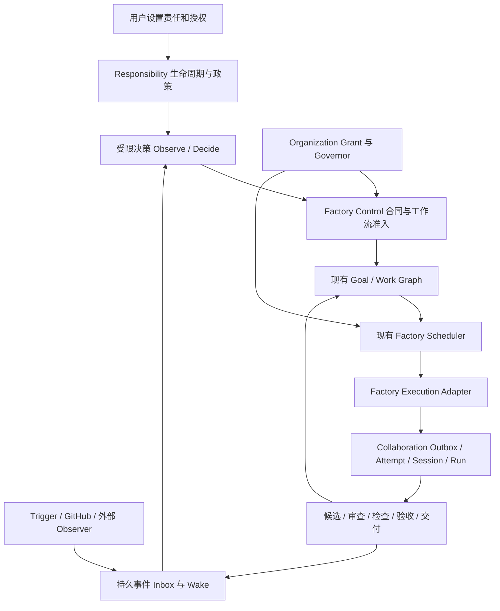

# Ragent 2.0 自治升级修订方案与代码审计

实施范围说明：Responsibility 是面向多种场景的通用持续目标和授权模型；GitHub CI 是首个验证路径，不是唯一用途。后续适配器须各自接入可信事实、受限工具授权和可核查结果；单独确认目标不构成任意工具授权。以下历史审计保留原基线，实际实现与验收状态以分阶段状态记录为准。

分阶段阅读与实施请从[阶段总览](ragent-2.0-autonomy/README.md)开始：[A 执行收敛](ragent-2.0-autonomy/phase-a-execution-closure.zh.md)、[B 责任与事件](ragent-2.0-autonomy/phase-b-responsibility-events.zh.md)、[C CI 自治闭环](ragent-2.0-autonomy/phase-c-github-ci-autonomy.zh.md)、[D 上下文与组织](ragent-2.0-autonomy/phase-d-context-organization.zh.md)、[E 设备与连接器](ragent-2.0-autonomy/phase-e-devices-connectors.zh.md)、[F 语音与体验](ragent-2.0-autonomy/phase-f-voice-experience.zh.md)。另见[共用架构](ragent-2.0-autonomy/architecture-and-boundaries.zh.md)和[验证发布规则](ragent-2.0-autonomy/verification-and-rollout.zh.md)。本文件保留完整审计上下文，阶段执行细节在分阶段文档维护。

Ragent 2.0 应在已有 Factory Work Graph 上补齐持续责任、事件准入和受限决策，先让现有执行链闭环，再扩展长期自治。当前最大的风险是已有模块之间尚未完整接通；继续按原方案新增 Goal-DAG、Scheduler 和执行状态存储，会增加竞争状态和恢复歧义。

审计基线为 `G:/AgentoC/Ragent_product` 的 `main`，提交 `baf143c3ecfe823e1dadc52f6ea2045e3e1d5c91`。本次阅读了启动、路由、领域存储、调度、执行适配、权限、预算、候选成果、验收、触发器、CI 观察入口、记忆、连接器及客户端接线。结论来自静态调用链和已有文档；没有运行 Harness、操作生产数据库、启动服务或执行测试。

工作区存在并行修改。审计过程中 `factory-checks.mjs`、`factory-execution-adapter.mjs`、`factory-integration.mjs` 继续发生变化，另有未跟踪的 `factory-integration-queue.mjs`。核心缺口以以上固定提交核对；工作区组合验证增量单独标为“开发中”，不能当作已交付能力，也不能在另一条开发线重复实现。本方案不覆盖原有 Factory 文档，不修改运行代码。

## 当前实现和原方案的关键差异

| 领域 | 可确认的源码事实 | 修订决定 |
| --- | --- | --- |
| 跨 Session 目标与任务 | `factory_goals`、`factory_work_items`、不可变合同、依赖、执行绑定、候选、验收和交付里程碑已经存在 | 复用 Work Graph；取消从零新建同等 GoalNode 和 ExecutionLink 的计划 |
| 后台执行 | Factory 已有轮询、租约、generation、CAS、原子容量认领及 Collaboration 适配 | Supervisor 只新增事件决策职责，不拥有第二套任务派发和重试权 |
| 持久责任 | Factory Goal 有 objective、验收基线、父目标、修订；尚不具备完整周期、订阅、长期授权和责任生命周期 | 新增薄层 Responsibility，链接现有 Goal 和工作流 |
| 动态组织 | Organization 已有节点、绑定代次、Grant、重新规划、消息、岗位配置和生命周期 | 先整合，之后再补自动选人和替换；不能把这些全部算新增 |
| 预算 | Governor 已有事务预留、结算、释放；Factory 预留跨组织修订累计且不自动过期 | 扩展责任范围与时间窗口；不重建成本账本 |
| 工程交付 | 有候选封存、独立审查意见、人工验收、注册检查、单候选集成和发布协议 | 先贯通证据链；组合验证正在开发，发布 provider 未等于实际可用 |
| Trigger | JSON 持久化、串行变更、定时和事件投递、重试及回复发布结果对账 | 复用入口和调度语义，但补持久事件 inbox；不能视为已有事务事件总线 |
| GitHub CI | `scripts/github-ci-auto-repair.mjs` 已轮询失败并创建 Session/Run | 改造成 Observer → Responsibility → Factory 的入口，保留现有采集和筛选逻辑 |
| Session Goal | 会话内续跑，最多 10 次、最小 5 秒间隔、连续 2 次无进展停止 | 保持兼容，不能作为跨 Session 责任权威 |
| Memory | Project Memory 的 SQLite 提交为权威，Markdown 为投影；有来源范围、任务租约和恢复 | 先组合事实与任务证据，后扩展用户记忆；不先建通用向量库 |
| 权限 | permission-policy/v3 已有 STANDARD / FULL_AUTONOMY、ONE_OPERATION / RUN / SESSION 能力范围、签名及 nonce 相关边界 | 产品自治等级映射到现有权限事实，避免另立互不兼容的模式枚举 |
| 客户端 | Web Tasks 入口和 Android FactoryWorkScreen 已接现有 Factory API | 增加责任和活动投影，复用任务控制页面 |
| 语音 | Android 和 voice connector 等仍有基础；旧 local-voice API 有明确 410 退役契约 | 不把旧本地语音服务列为直接恢复对象 |

主要依据：`chat/work-graph-store.mjs:4`、`chat/work-graph.mjs:53`、`chat/factory-runtime.mjs:13`、`chat/factory-scheduler.mjs:12`、`chat/factory-execution-adapter.mjs:138`、`chat/organization-governor.mjs:264`、`chat/triggers.mjs:1`、`chat/session-goal.mjs:19`、`chat/project-memory-store.mjs:1`、`chat/permission-policy.mjs:27`、`static/chat/organization-view.js:758`、`tests/test-retired-voice-routes.mjs:1`。文件行号是审计定位提示；固定提交优先于持续变化的工作区行号。

## 必须前置处理的执行缺口

以下是静态路径可见的问题及其后果推断，不是已完成故障注入的运行结论。

### 依赖任务尚不能完整自动推进

`ApproveContract` 会把有未满足依赖的任务置为 `blocked`；`listFactoryReadyWork` 只查询 `ready`。Scheduler 会对 blocked 项调用 adapter，但 adapter 在没有执行绑定时直接返回。上游验收完成后，没有看到自动把纯依赖阻塞项推进为 ready 的消费路径。当前可通过显式 `RetryWork` 重新计算依赖，但后台 scheduler 的服务授权不包含该命令。

另外，`instantiateFactoryWorkflow` 将 `candidate_ready` 依赖的摘要置为 null，后续 eligibility 和 validation workspace 均要求固定候选摘要。不能仅把前驱标为完成就自动放行审查；必须明确候选产生后由哪个受限命令绑定摘要、核对合同版本并推进后继。

改造：增加 Work Graph 内部的依赖对账命令，按前驱里程碑、当前合同和候选代次更新。区分依赖解除与执行重试；不要为了唤醒任务消耗重试次数或重新授权整个合同。证据：`work-graph.mjs:43,74,81`、`factory-control.mjs:33`、`factory-scheduler.mjs:37`、`factory-execution-adapter.mjs:200`、`factory-workflow.mjs:47`。

### 失败和取消尚缺完整的终态映射

`updateFactoryBinding` 提供 `fail`，但基线 adapter 的 reconcile 主要处理成功封存、绑定 Run、撤权和请求停止，未调用该失败转换。普通失败、派发失败且没有 runId、自然取消等路径不能仅靠成功分支收敛。暂停/取消分支又要求 Run 与 Attempt 同时为 cancelled；若任务在取消请求到达时已经 completed 或 failed，需要另行判断真实结果和业务取消语义。

改造：明确每一类 Attempt/Run 结果如何更新 binding、Work Item、容量和预算。缺失 Run 不能视为未执行；外部效果不明进入可查询的 unknown。基线 adapter 成功分支还依赖 `sourceContext.managedWriter`，需确认只读审查任务是否能提供相应候选或专用审查结果，避免复用“写任务产物”要求阻塞只读任务。证据：`factory-control.mjs:14`、`factory-execution-adapter.mjs:200` 及其成功/取消分支。

### 派发恢复需要可验证地接管旧意图

Collaboration outbox 在实际发消息前重新检查 Factory fence，这是应保留的边界。但持久 `factoryExecution` 包含原 scheduler 的 ownerToken 和 leaseGeneration；重启后的调度租约发生变化，而已有 Collaboration 会继续携带原上下文。`dispatchFactory` 还要求同幂等键上下文完全一致。

改造：区分“尚未受理”“已经受理但回执未写入”“效果未知”。先按原 requestId 查 Run/回执；确实未受理时，以持久接管操作更新可派发授权并重新检查政策，不直接替换业务幂等键，也不放松 fence。证据：`collaboration-orchestrator.mjs:685,1420`、`factory-execution-adapter.mjs:64,200`。现有保守拒绝不等于已经实现重启续行。

### 死信状态与继续观察语义不清

`recordFactoryReconciliationFailure` 达到上限后写 `dead_letter`，但 `factoryReconciliationDue` 只判断时间，仍允许后续 reconcile。adapter 的 reconcile 在特定条件下会再次 dispatch，因此这里不能把“继续观察”和“继续行动”混在一起。

改造：死信后继续读取真实执行状态，停止产生新副作用；恢复需要显式命令或明确政策。错误次数、下一次只读观察时间、允许再次行动的条件分别表达。证据：`factory-reconciliation.mjs:15,20`、`factory-scheduler.mjs:37`、`factory-execution-adapter.mjs:210`。

### 工作流和验收仍有人工接点

Factory workflow 编译器明确不分配执行人、不批准合同、不启动工作；默认模板版本为 1，版本 2 才要求独立审查。模板多项验收是 `manual`。注册检查和检查验收也要求 owner，基线路由没有把全部检查、集成入口接成后台工作流。仅存在这些模块，不能证明一次授权后可以自动完成完整流程。

改造：保留人工验收；为明确授权的模板增加受限的 workflow admission 和证据处理主体。该主体只能实例化固定模板、选择满足约束的节点、接受真实检查结果，不冒充 owner，不允许模型把人工审批条目改成自动通过。

注册检查当前只接受特定 `codex-app-server-json` 的显式 provider exit code 与 cwd。MVP 要按实际证据能力选 Harness；Claude 等通道可以执行任务，不代表自动获得相同检查证明。证据：`factory-workflow.mjs:33,40`、`factory-checks.mjs:32,40`、`factory-acceptance.mjs:47`、`work-graph.mjs:14`、`router-factory-routes.mjs:42`。

### 预算有可靠基础，但尚不能承诺严格每日费用封顶

Factory 已原子预留且跨 revision 累计，不能再列作待从零实现。当前 reconcile 只在拿到归属于该 Run、同时含实际成本和 Token 的 provider 总量事件后结算；缺失时一直保留预留，是保守行为，也会形成长期占用。预留量本身不限制一个正在运行的模型实际消耗；实际超额仍需要如实入账。

改造：补预算预留失败后的任务处置、已证实未启动时的释放、缺失用量的核实入口。每日预算明确时区、窗口、跨日归属和责任范围；保留组织总预算。若 provider 不支持强制限制单次成本，界面明确展示估计/未知及超额处置，不能把预留说成硬上限。证据：`organization-governor.mjs:264,334,384`、`factory-execution-adapter.mjs:16,162,228`。

## 调整后的状态权威和架构

Responsibility 表达“持续承担什么、何时再观察、何种情况下允许产生工作”；Factory Goal 表达某轮工作目标；Work Item 表达可验收任务。长期责任可以多次产生 Goal 或 Workflow Instance，旧 Goal 不反复清空重用。首版限定一个 Responsibility 属于一个项目和一个 Organization；跨项目协调之后增加上层聚合，不先支持任意多对多授权。

| 事实 | 唯一领域权威 | 新层允许做什么 |
| --- | --- | --- |
| 长期责任、订阅、责任版本、持续授权 | 新 Responsibility 领域，建议加法表放入 collaborations.sqlite | 修改责任定义、撤销准入、记录观察和决定 |
| 目标、任务合同、依赖、业务验收 | 现有 Work Graph | 提交受限命令，不能复制一套 task state |
| 组织节点、Grant、岗位和绑定 | Organization | 查询或提交组织命令 |
| 执行派发与 Attempt | Collaboration Store 和 outbox | 保持已有派发入口 |
| 进程与 Run 实际状态 | Run/Session 执行链 | 查询、受控取消，不能从目标状态反推执行成功 |
| 预算及实际用量 | Organization Governor | 增加责任/窗口维度，不建立另一套费用真相 |
| 编排观测和中断 | Orchestration Ledger | 关联、镜像、查询；不能替代 Work Graph 验收 |
| 项目记忆 | Project Memory SQLite | 引用已提交版本和来源，不从摘要改权限 |
| 外部效果 | Connector 操作记录与外部回执 | 查询、幂等重试或等待核实 |

`orchestration-reconciler.mjs:1` 明确声明领域存储仍为权威，只修复账本、处理等待期限和报告停滞。新设计不应赋予它第二套业务调度权。ResultPacket、资源锁、Run 文件和 Project Memory 仍跨不同存储，无法靠同一个 SQLite 事务承诺全系统 exactly-once。

## Responsibility 和事件层的最小设计

推荐保留新的责任实体，但缩减原建议数据模型：

| 新增事实 | 最小字段与约束 |
| --- | --- |
| Responsibility | id、ownerPrincipalId、projectId、organizationId、objective、successCriteria、lifecycle、revision、rowVersion、policyRevision、nextCheckAt |
| Policy revision | 允许模板、资源范围、允许工具动作、审批条件、有效期、失败/并发限制、预算范围；版本不可变 |
| Subscription | responsibilityId、source、resource、eventTypes、过滤与冷却、启用状态、水位 |
| Inbound event | source/account/resource/eventId 唯一键、occurredAt、receivedAt、payloadDigest、payloadRef、来源验证状态 |
| Wake | responsibilityId、责任/政策版本、关联事件集合、dueAt、state、leaseGeneration、decisionId；合并必须保留原事件关联 |
| Decision receipt | 输入事实摘要、候选提案、确定性验证结论、使用量、结果命令及版本；模型输出仅是提案 |
| Responsibility work link | responsibilityId、wakeId、goalId/workflowInstanceId；引用已有 binding/Execution，不另存执行终态 |

生命周期采用 draft / active / paused / completed / cancelled / archived。等待审批、设备离线、预算不足放在带原因和解除条件的 attention/blocker 中，避免长期责任因某一轮 CI 失败整体变成不可恢复终态。“持续维护”默认不会因一次修复完成而 completed；completed 必须来自有限责任完成或明确用户结束。

责任暂停先禁止新决策/派发，再按用户选择对现有工作请求停止；“暂停已请求”与“执行已停止”分别显示。政策撤销在决定、合同准入、实际派发和工具副作用前检查，已产生的外部效果保留记录。

事件接入优先将 `triggers.mjs` 的 action 扩展为受控责任唤醒，保留旧 session_message。新责任事件以 SQLite inbox 为权威；若旧 Trigger 配置继续放 JSON，使用稳定 occurrenceId 和幂等桥接，不能跨 JSON/SQLite 宣称原子提交。首版保持单权威实例，避免让多个进程同时改旧 JSON 文件。

现有 Trigger 的真正类型为 at_time / event；interval 是 recurrence。事件白名单主要是 Run/Collaboration/Process/Session，且只保留有限事件键。外部事件必须新增来源验证、去重保留期和持久原始证据；“复用 Trigger”不代表直接把任意 Webhook 文本交给聊天即可。

API 可以保留原方案的 `/api/responsibilities` 用户入口，但内部通过现有 Factory Control 提交工作。所有写入使用明确 actor、expectedVersion 和稳定幂等键；同键异内容拒绝。wake 接口只返回持久受理回执，不承诺已启动或已完成。

## Supervisor 的职责收缩

Observe 读取事件、当前责任、关联 Work Graph、组织授权、预算和真实运行事实；无新信息不调用模型。Decide 首版使用 CI 维护固定政策和工作流模板，确有必要时才让模型提出诊断或重新规划建议。Dispatch 指提交经过验证的 Factory 命令，Run 派发仍归现有 Scheduler。

新服务主体必须有独立、有限的 capability；不能复用 owner，也不能仅因名称为 supervisor 自动获得所有 `factory.*`。首次授权约束模板版本、仓库、目标分支、可写路径、检查命令及发布权限。外部日志和记忆只能提供事实，不能扩展这些约束。

责任输入摘要不变、已有关联任务未结束、冷却未到、预算不足、授权过期时，确定性代码作出等待决定。每次唤醒有事件、决定、工作流、Work Item、Run、候选和回执链；成功不依赖 Agent 的一句“已完成”。

## 重新排序的实施路线

| 阶段 | 实施范围 | 退出条件 |
| --- | --- | --- |
| A 基线固定和执行收敛 | 合并确认当前 Factory 开发边界；补依赖推进、候选绑定、终态映射、旧派发接管、死信行为、预算占用处置；补齐调用入口 | 一个已授权工作流能够形成真实候选、真实检查证据和明确验收；失败/取消/未知能落到可处理状态 |
| B 持续责任与持久事件 | Responsibility、政策版本、订阅/inbox/wake、责任与现有 Goal 关联、暂停/撤权、Activity 基础投影 | 重启后责任和待处理事件可恢复，同逻辑事件不会重复生成业务工作 |
| C GitHub CI 自治闭环 | 迁移已有 CI 观察脚本；固定模板准入；受限主体；审批与主动汇报 | 一次责任授权后能从真实 CI 事件推进到候选和审查；需要审批时停止并准确提示，恢复不重复派发 |
| D 长期上下文与组织调整 | 结构化 handoff、来源与有效性、Goal 修订影响分析、Harness 替换、预算窗口和成本分工 | 替换执行者后仍保持合同、依赖、授权和证据版本一致 |
| E 跨设备和外部动作 | 扩展现有 target runtime 能力、容量与授予；跨设备回执；GitHub/Gmail/Calendar/Drive 动作策略 | 区分未派发、已受理、效果未知；断网后正确查询结果并遵守独立传输授权 |
| F 语音与体验 | 在当前 Android/语音入口上接责任查询和变更；上下文续接、打断及审批引导 | 语音调用同一业务命令，识别结果不直接触发敏感授权 |

Ragent 2.0 MVP = A + B + C。新增责任与恢复基础不宜在 A 尚未明确之前大规模铺开。排期先按真实依赖拆交付，再根据 A 的贯通结果估时；当前不沿用原文所有阶段的周数，也不给源码存在换算完成百分比。

### GitHub CI MVP 的实际边界

复用已有脚本按 branch/workflow 选择最新失败、settle window、日志采集及快照。改造的首要目标是停止由观察器直接用 owner cookie 创建普通修复 Session，改为投递受限的持久事件。旧逻辑在切换时明确单入口归属，防止旧脚本和新服务同时修同一个故障。

事件身份纳入 repository、workflow run、run attempt 和 head SHA，既去重重复投递，也识别 rerun 和已过时失败；派发前重新核对该失败是否仍需要行动。保存旧 handledRuns 与新事件身份映射，不迁移成“修复已成功”。

第一版交付为固定候选、来源明确的现有检查、独立意见及待用户处理的结果。PR 是独立外部发布动作：用户授权创建前先准备可审查结果；创建时固定仓库、base/head、候选摘要和审批版本。仅在实现可查询回执与恢复协议后开放自动创建 PR，不把“草稿 PR”视为天然无外部副作用。自动合并和生产发布不属于 MVP 默认范围。

原脚本提示会让 Agent 直接工作在本地仓库并在验证后创建远程 checkpoint；这不能替代新责任的分支/路径隔离和审批政策。参考 `scripts/github-ci-auto-repair.mjs:650,752`。

### 后续功能的具体收缩

记忆先由责任定义、当前合同、源事件、ResultPacket 和已验证 Project Memory 组装上下文。责任进度直接从权威记录投影，不在“Responsibility Memory”中再手写一个进度副本。User Memory 需单独的用户查看、更正、删除和来源界面。

设备能力描述必须区分“软件已安装”“当前在线”“当前主体被授权”“实际可强制隔离”。现有 target-runtime 的精确 method/path 授权是可复用基础；Agent Capability 不是设备注册表。先一个实例统一派发，再增加远程执行适配，不直接宣称跨设备透明迁移。

Connector SDK 当前主要解决入站消息创建/复用 Session、投递、重试和死信。`connector-action-dispatcher.mjs` 则主要处理完成后的 email/calendar 目标。OAuth scope、入站传输成功和自治动作许可是不同事实。逐个动作补政策、幂等、回执、结果查询和 unknown_outcome；不要在既有函数外仅套一层统一字段就宣布安全统一。

语音继续使用当前入口和适配器；`tests/test-retired-voice-routes.mjs` 要求旧 local-voice 返回 410。原方案不能因旧组件文件仍存在而恢复退役服务。

## 模块和接口调整清单

| 原建议 | 调整后 |
| --- | --- |
| 新建完整 responsibility-scheduler | 责任层只安排 wake；Work Item 调度仍由 factory-scheduler 承担 |
| 新建独立 Goal-DAG Engine | 扩展 work-graph 的依赖推进、目标修订和失效协议 |
| 新建整套 ExecutionLink 状态 | 新增关联表，引用已有 factory_execution_bindings 和 orchestration ID |
| 新建 Policy & Budget 系统 | Responsibility policy 编译到现有 permission/capability 和 Governor；新增责任范围，不重复计费 |
| 一次创建五个 supervisor 模块 | 先小规模 observe/decision/Factory command adapter，按职责和代码规模再拆分 |
| 全新 Responsibilities 管理后台 | 在现有组织任务视图上增加责任入口、活动记录和审批摘要 |
| 先补四种连接器完整生态 | MVP 只贯通 GitHub CI 读取及受控交付，其余动作后移 |

建议新增 `responsibility-store.mjs`、`responsibility-service.mjs`、`responsibility-events.mjs`、`responsibility-decision.mjs` 和责任路由；这些是待评审的职责建议，不是本次已经创建的模块。启动与停机复用现有 chat-server 生命周期，不建立新的常驻管理员进程。

## 验证和发布证据

采用六列能力基线：源码存在、生产调用接线、默认/实际配置、现有可信检查、真实业务验收、发布版本。相比原方案，单独增加“接线”和“实例配置”，因为本次发现多个模块存在但未形成自动调用闭环。

| 证据范围 | 当前可以说什么 | 不能据此推出什么 |
| --- | --- | --- |
| 本次源码审计 | 固定提交的控制流、表结构、权限边界及调用缺口 | 真实服务安全、跨平台通过或已经发布 |
| 现有 Factory implementation-status | 文档记录部分旧 Collaboration/投影检查通过，phase-gates 和 autonomous-organization-s22 有失败记录 | 本轮已重跑、失败已经修复，或新 Factory 已通过 |
| Factory 专用验证 | 本次在 tests 中未找到直接引用核心 Work Graph/Factory scheduler/adapter 的专用检查 | 无需验收，或可以用旧测试的总通过数代替 |
| 客户端源码 | Web/Android 已有基础任务入口 | 真机、断线重连或完整业务链已验收 |
| 发布/备份模块 | 有协议和工具实现 | 实际 provider 已发布、跨库恢复已经验证 |

遵守工作区 Evidence First 规则：本次不新增测试、mock、探针或演示数据。后续先实现，再审阅直接依赖，选择既有可信检查。新测试和故障注入基础设施需要明确授权；不把原文“180 个场景”当作已批准任务。可靠性验收应围绕实际系统断点，而不是凑数量：事件持久后、工作意图提交后、Run 受理未回执、候选封存后、审批后目标变化、外部写出后未收到回执。

现有检查按改动选择：Trigger 对应 `test-http-triggers.mjs`；旧执行基础对应 `test-collaboration-store.mjs`、`test-collaboration-orchestrator.mjs`；账本对应 `test-orchestration-store.mjs` / `test-orchestration-reconciler.mjs`；组织预算和恢复需核对 S22/S23 等既有场景实际覆盖；权限对应既有 permission-policy、capability-grant 和 execution-boundary 检查。旧 fixture 不符合新行为时，先核对契约变更，不擅改 expected output 让检查变绿。

保持 Factory 默认不准入新工作。现有控制开关检查 `AGENTOC_FACTORY_CONTROL_ENABLED === 'true'`，scheduler 开关检查 `AGENTOC_FACTORY_SCHEDULER_ENABLED === '1'`，组织白名单、owner 授权来源和 Governor 另有前提；这应统一配置解析并在能力页展示拒绝原因。关闭新准入后继续观察已有工作，避免开关关闭导致状态失联。

发布先单项目、单组织、单权威实例、经验证的 Harness/平台组合。灰度前记录数据库与产物备份边界；回滚先关新事件准入和新派发，保留读取、取消和对账。已执行外部操作不靠数据库回滚撤销；unknown 保留人工核实。加法迁移不得删除历史 Session、Run、候选或旧责任证据。

## 本次交付边界

本次新增这一份审计和修订方案，没有修改运行实现、调整功能开关或部署服务。所有工程产物保留在 G:。下一步开发顺序应首先处理 A 阶段的已有执行闭环，再接 B/C 的持续责任和真实 CI 入口；已有 Factory 组合验证的并行修改应先确认归属与提交状态。

相关源码可从以下入口复核：

- [Work Graph 表结构](../chat/work-graph-store.mjs)、[领域命令与依赖](../chat/work-graph.mjs)、[Factory Control](../chat/factory-control.mjs)。
- [Scheduler](../chat/factory-scheduler.mjs)、[执行与恢复适配](../chat/factory-execution-adapter.mjs)、[对账失败处理](../chat/factory-reconciliation.mjs)、[Collaboration 派发](../chat/collaboration-orchestrator.mjs)。
- [工作流模板](../chat/factory-workflow.mjs)、[检查证据](../chat/factory-checks.mjs)、[验收](../chat/factory-acceptance.mjs)、[预算](../chat/organization-governor.mjs)。
- [Trigger](../chat/triggers.mjs)、[已有 CI 入口](../scripts/github-ci-auto-repair.mjs)、[Project Memory](../chat/project-memory-store.mjs)、[权限协议](../chat/permission-policy.mjs)。
- [Factory API](../chat/router-factory-routes.mjs)、[已有实施状态与验证记录](factory-runtime/implementation-status.zh.md)。后者是并行维护文档，不替代固定提交的源码证据。
