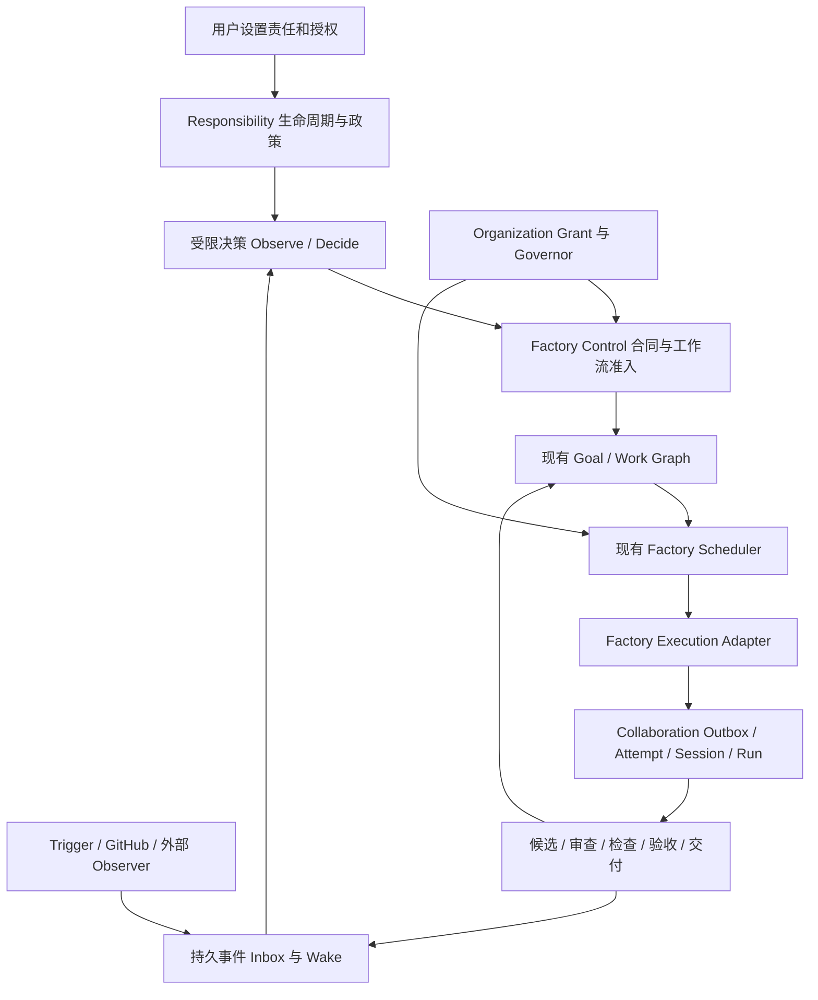

# 共用架构和状态权威

[返回阶段总览](README.md) · [验证与发布规则](verification-and-rollout.zh.md)

适用于 A–F 全部阶段。以下内容继承原修订方案，状态判断对应原审计基线；模型只能提出方案，状态转换、授权、预算和去重由确定性代码执行。

## 调整后的状态权威和架构

Responsibility 表达“持续承担什么、何时再观察、何种情况下允许产生工作”；Factory Goal 表达某轮工作目标；Work Item 表达可验收任务。长期责任可以多次产生 Goal 或 Workflow Instance，旧 Goal 不反复清空重用。首版限定一个 Responsibility 属于一个项目和一个 Organization；跨项目协调之后增加上层聚合，不先支持任意多对多授权。

| 事实 | 唯一领域权威 | 新层允许做什么 |
| --- | --- | --- |
| 长期责任、订阅、责任版本、持续授权 | 新 Responsibility 领域，建议加法表放入 collaborations.sqlite | 修改责任定义、撤销准入、记录观察和决定 |
| 目标、任务合同、依赖、业务验收 | 现有 Work Graph | 提交受限命令，不能复制一套 task state |
| 组织节点、Grant、岗位和绑定 | Organization | 查询或提交组织命令 |
| 执行派发与 Attempt | Collaboration Store 和 outbox | 保持已有派发入口 |
| 进程与 Run 实际状态 | Run/Session 执行链 | 查询、受控取消，不能从目标状态反推执行成功 |
| 预算及实际用量 | Organization Governor | 增加责任/窗口维度，不建立另一套费用真相 |
| 编排观测和中断 | Orchestration Ledger | 关联、镜像、查询；不能替代 Work Graph 验收 |
| 项目记忆 | Project Memory SQLite | 引用已提交版本和来源，不从摘要改权限 |
| 外部效果 | Connector 操作记录与外部回执 | 查询、幂等重试或等待核实 |

`orchestration-reconciler.mjs:1` 明确声明领域存储仍为权威，只修复账本、处理等待期限和报告停滞。新设计不应赋予它第二套业务调度权。ResultPacket、资源锁、Run 文件和 Project Memory 仍跨不同存储，无法靠同一个 SQLite 事务承诺全系统 exactly-once。

## 模块和接口调整清单

| 原建议 | 调整后 |
| --- | --- |
| 新建完整 responsibility-scheduler | 责任层只安排 wake；Work Item 调度仍由 factory-scheduler 承担 |
| 新建独立 Goal-DAG Engine | 扩展 work-graph 的依赖推进、目标修订和失效协议 |
| 新建整套 ExecutionLink 状态 | 新增关联表，引用已有 factory_execution_bindings 和 orchestration ID |
| 新建 Policy & Budget 系统 | Responsibility policy 编译到现有 permission/capability 和 Governor；新增责任范围，不重复计费 |
| 一次创建五个 supervisor 模块 | 先小规模 observe/decision/Factory command adapter，按职责和代码规模再拆分 |
| 全新 Responsibilities 管理后台 | 在现有组织任务视图上增加责任入口、活动记录和审批摘要 |
| 先补四种连接器完整生态 | MVP 只贯通 GitHub CI 读取及受控交付，其余动作后移 |

责任存储、服务、事件、决策和路由现已在工作区形成源码接线；运行默认关闭，具体范围和证据见[实施状态](implementation-status.zh.md)。启动与停机复用现有 chat-server 生命周期，不建立新的常驻管理员进程。
## 阶段间接口

- A 提供可恢复的 Work Item、执行绑定、候选和验收事实。
- B 提供持久责任、政策版本、事件身份与唤醒回执，并引用 A 的事实。
- C 将决策转换成受限 Factory 命令，不直接调用 Runner。
- D 基于上述事实组装上下文和交接，不复制任务状态。
- E 扩展执行地点和外部动作，沿用同一授权、回执及未知结果协议。
- F 调用业务命令和投影视图，不增加语音专属权限通道。
