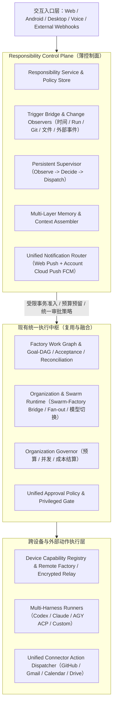

# Ragent Full 2.0 完整升级方案（基于 2026-11-22 代码基线）

> **文档日期**：2026-11-22  
> **审计基线**：`G:/AgentoC/Ragent_product` 主分支 `main` 提交 `df64864f`（较 2026-11-14 自治阶段提交 `a4af91e1` 新增 282 个提交）  
> **关联文档**：  
> - 前序修订方案：[ragent-2.0-autonomy-revised-plan-2026-11-13.zh.md](ragent-2.0-autonomy-revised-plan-2026-11-13.zh.md)  
> - 分阶段拆解目录：[ragent-2.0-autonomy/README.md](ragent-2.0-autonomy/README.md)  
> - 11-14 实施与剩余清单：[implementation-status.zh.md](ragent-2.0-autonomy/implementation-status.zh.md)、[remaining-work.zh.md](ragent-2.0-autonomy/remaining-work.zh.md)  
> - 新底座设计文档：[multi-agent-swarm-and-agy-adapter-plan.zh.md](multi-agent-swarm-and-agy-adapter-plan.zh.md)、[organization-agent-runtime-plan.zh.md](organization-agent-runtime-plan.zh.md)、[cloud-push.md](cloud-push.md)、[approval-policy-design.zh.md](approval-policy-design.zh.md)、[attachment-encrypted-relay-large-files.zh.md](attachment-encrypted-relay-large-files.zh.md)

---

## 一、核心目标与 Full 2.0 产品终态

### 1.1 产品定位升级
将 Ragent 从**“跨设备 AI Agent 工作台”**渐进式升级为**“能够长期自主推进目标、动态指挥多 Agent 组织、安全操作多台用户设备与外部应用的个人 Agent 平台”**。

Ragent 借鉴持续自治 Agent（如 GPT Dot）的工作方式，同时保留自身核心差异化优势：**本地优先运行、跨设备真实执行、可替换多 Harness（Codex / Claude / AGY ACP / Custom）以及确定性安全治理**。

### 1.2 三种并存的用户工作模式
1. **直接控制**：像现有工作台一样直接连接 Codex、Claude、AGY 等 Harness，管理 Session、Run 与本机/远端设备。
2. **任务委托**：交代复杂一次性目标，Ragent 自动规划、组建多 Agent 组织或 Swarm 团队、并行执行、独立审查并交付。
3. **长期自治（2.0 核心增量）**：用户交代持续性责任（Responsibility），Ragent 在会话之外持续观察环境变化、决策下一步、调度组织执行、在中断/重启后恢复、仅在必要时请求审批并主动汇报。

### 1.3 Full 2.0 六大端到端目标场景
- **场景 A（通用长期项目维护）**：持续跟踪项目进展、资料或 CI 变化，自动调查阻塞、生成报告或低风险修复草稿，高风险变更/PR 提交前交用户审批。
- **场景 B（跨设备智能管家）**：根据设备在线状态、能力标签与授权边界自动选择 Windows / macOS / Linux 节点执行任务并传输产物，离线不丢任务、不重放副作用。
- **场景 C（多 Agent 组织与 Swarm 协同）**：根据任务复杂度动态组建 Manager / Specialist / Writer / Reviewer 团队或拉起 Swarm 协作，按成本分级切换模型，失败自动接管。
- **场景 D（自然语音连续交互）**：在手机或桌面通过语音查询真实任务进展、连续追问、语音打断、跨设备续接上下文，高风险动作转入可视化审批卡片确认。
- **场景 E（多层可治理记忆）**：系统记住用户偏好、项目约束、责任进度与历史故障经验，标注来源与置信度，支持用户查看、更正、撤回与冲突裁决。
- **场景 F（边界清晰的可控自治）**：所有自主动作受确定性策略、预算与审批边界约束；子 Agent 权限不越界；无法证实外部结果时进入 `unknown_outcome`，绝不盲目重放。

> **核心范围原则**：Ragent 2.0 是**通用长期自治平台**。GitHub CI 只是众多适配器示例之一，项目资料报告、本地代码维护、跨设备文件与日程/邮件协作均是一等目标场景。

---

## 二、2026-11-22 仓库最新现状全景审计

11 月 14 日至 11 月 22 日的 282 次提交使 Ragent 形成了**“执行与协同底座大幅领先、长期自治层停留在 11-14 源码态”**的现状。Full 2.0 方案必须直接复用新底座，杜绝重复建设。

### 2.1 已建成的五大新底座（11-14 ~ 11-22 新增/强化）
1. **Organization Runtime 成熟化（138 次提交）**：
   - 补齐组织规划提案 schema 受控修复、能力发现、阶段汇总（aggregation）、托管 Agent 身份、delegated run 中断恢复与 incident 持久化/去重。
2. **AGY ACP + Ragent Swarm Mode（Phase 0–3 全部落地）**：
   - Phase 1（`ffec4c51`）：AGY 1.5.12 ACP 运行时、双向 MCP/Skills、原生 delegation 投影。
   - Phase 2（`fc7ba5db`）：Swarm 核心原语（共享消息板、worker roster、Web Swarm Board）。
   - Phase 3（`c55c8d2e`）：Swarm 受控模型切换、**Swarm ↔ Factory 桥接**（`chat/organization-swarm-factory-bridge.mjs`）、**确定性 Fan-out 执行器**（`chat/factory-fanout-executor.mjs`）。
   - Wave 2 多平台验收 P0/P1 修复（`fba8b715`）：补齐 Android Swarm Board、org aggregation、Codex/Claude MCP 与 macOS flags。
3. **账号级可靠云推送（Account Cloud Push）**：
   - `51ab901a` 落地 `chat/account-push-outbox.mjs`、`chat/attention-push.mjs` 与 `docs/cloud-push.md`：通过 Accounts 服务转发 Android FCM，本地 outbox 持久化、重启自动重试、带事件过期与序列号防旧通知复活。
4. **统一审批决策策略与安全隔离**：
   - `0b69a56b` 落地 `chat/approval-policy.mjs`、`docs/approval-policy-design.zh.md`：POSIX AST 保留参数边界、cwd guard 绑定、复合命令取最严格结果、决策/审计/卡片统一消费同一原因码；同步修复 Windows Broker 权限与 Linux 只读 sandbox 隔离。
5. **Android 与跨平台交付能力大幅齐平（109 次提交）**：
   - Android Organization UI 重构、Swarm Board、Claude 认证、离线成员投影、Codex 断线状态保留；原生 Linux DEB / RHEL 9 RPM 与 Windows 桌面/机器包分离就位。

### 2.2 能力现状矩阵（代码 / 测试 / 真实验收 / 默认状态）

| 能力域 | 现有核心模块 | 代码状态 | 验收状态 | 默认开关/限制 |
|---|---|---|---|---|
| **Responsibility 控制面** | `responsibility-store.mjs` / `service` / `runtime` / `decision` / `plans` / `trigger-bridge` / `trigger-events` | MVP 源码已接通（支持报告、本地代码、CI、生命周期、时间/根 Run 事件桥、Git HEAD 变化） | **未完成真实非 CI 端到端闭环与重启验收** | `RAGENT_RESPONSIBILITY_RUNTIME_ENABLED` 默认关闭 |
| **Factory Work Graph** | `work-graph.mjs` / `factory-control.mjs` / `reconciliation` / `acceptance` / `goal-revision` / `fanout-executor` | 完整持久图、依赖推进、候选封存、审查验收、多根局部修订、Fan-out 已落地 | Fan-out/Swarm Bridge 有单元测试；自治重启/未知结果恢复缺真实业务验收 | 需组织白名单与 Governor |
| **Swarm & 多 Agent 组织** | `organization-swarm.mjs` / `organization-swarm-factory-bridge.mjs` | Phase 0–3 落地，支持共享板、模型切换、Factory 桥接、Web/Android UI | 已通过 Wave 2 多平台验收修复与多项回归测试 | **尚未与 Responsibility Supervisor 打通** |
| **主动通知与云推送** | `account-push-outbox.mjs` + `responsibility-notifications.mjs` | Account Cloud Push（FCM）已独立落地；Responsibility 仅接了定向 Web Push 源码 | Responsibility 推送未验收；**两者尚未合流** | `RAGENT_RESPONSIBILITY_PUSH_ENABLED` 默认关闭 |
| **多层记忆与冲突治理** | `project-memory-engine.mjs` / `responsibility-memory.mjs` / `responsibility-context.mjs` | 项目记忆 + 同键/手选冲突人工审阅 + 版本化更正/撤回源码已接通 | 缺真实并发恢复验收；**缺 User Memory、Episodic Memory 与语义冲突发现** | `RAGENT_RESPONSIBILITY_MEMORY_WRITES_ENABLED` 默认关闭 |
| **跨设备执行与传输** | `remote-factory-*.mjs` / `remote-file-transfer.mjs` | 双端固定绑定签名派发/取消/候选导入 + 4 MiB 单文件传输源码已接通 | **未做双实例真实验收**；缺自动设备能力发现/路由与大文件/目录传输 | `RAGENT_REMOTE_FACTORY_ENABLED` / `FILE_TRANSFER` 默认关闭 |
| **外部连接器（Connectors）** | `lib/connector-action-dispatcher.mjs` / `connector-github/gmail/calendar/drive.mjs` | 四个连接器均有模块；Calendar 支持确定性 ID 回执，邮件未知转人工核查 | **缺统一动作契约、GitHub PR 读写闭环与 Drive 完整闭环**；未接入通用 Planner 目录 | 仅部分技能/手工调用 |
| **自然语音管家** | `android/feature/organization` / 本地 ASR & TTS 组件 | 仅支持手动 ASR 草稿传入审阅 + 显式 TTS 朗读 | 未做真机语音验收；**缺免手持连续对话、打断与跨设备续接** | 手动交互入口 |

---

## 三、Full 2.0 目标架构与状态权威边界

### 3.1 总体分层架构（复用新底座，拒绝平行重造）

### 3.2 对象分层与状态权威归属

必须严格维持对象解耦：`Responsibility`（长期持续职责）≠ `Goal / WorkItem`（单轮结构化工作图）≠ `Swarm / Organization Execution`（多 Agent 协同过程）≠ `Session / Run`（具体 Harness 执行实例）。

| 状态域 | 唯一权威存储 | 核心职责与变更边界 |
|---|---|---|
| 长期责任、策略版本、事件、Wake、决策与计划 | `collaboration-store` SQLite 中的 `responsibilities*` 表（`chat/responsibility-store.mjs`） | 乐观锁 `row_version` + 不可变策略/计划/决策/观察触发器；归档不删历史执行 |
| 任务图、依赖、合同、候选、审查与验收 | `work-graph-store` SQLite（`chat/work-graph*.mjs`、`factory-*.mjs`） | 管理每轮可执行任务的状态机、产物摘要、独立审查与 owner 验收 |
| 多 Agent 协同、消息板与模型切换 | `organization-store` SQLite（`chat/organization-swarm.mjs`） | 仅在 Factory 授权工作项内执行协同，通过 `organization-swarm-factory-bridge.mjs` 提交候选 |
| 预算预留与实际用量结算 | `organization-governor.mjs` + `factory-run-budget.mjs` | 派发前原子预留；未知用量保留预留不归零；区分“准入预算”与“Provider 硬封顶” |
| 记忆事实与版本历史 | `project-memory-store.mjs` + 新增 User/Episodic 记忆表 | 区分用户明确规则、工具验证事实、模型推测；更正/撤回生成新版本，不静默抹除历史 |
| 通知投递与云推送队列 | `responsibility_notification_outbox` + `account-push-outbox.json` | 幂等去重、过期防复活；provider 受理不等于用户已读 |

### 3.3 六条不可违背的工程红线
1. **确定性代码掌权**：调度、权限、预算预留、状态转换、租约 Fencing、事件去重必须由确定性代码完成，严禁靠 Prompt 维持核心控制流。
2. **权限严格取交集**：任何子 Agent / Swarm Worker / 远端节点的有效权限不得超过 `Owner 授权 ∩ Responsibility Policy ∩ WorkItem 合同 ∩ 设备沙箱/审批门`；不向 Supervisor 授予永久管理员权限（Windows Privileged Broker 仍受限审计）。
3. **外部副作用 `unknown_outcome` 铁律**：跨数据库与外部 API 无法天然 Exactly-once；任何越过发送边界但未获权威回执的操作必须标记 `unknown_outcome` 并通过外部查询核实或转人工，严禁盲目重放。
4. **通用化而非单一场景写死**：所有控制面 API、决策、通知与 UI 面向通用 Responsibility；GitHub CI、资料报告、代码维护、连接器动作均以能力目录与适配器接入。
5. **证据驱动验收（Evidence First）**：静态检查、语法通过或离线编译不等于业务验收；每个阶段退出必须有可追溯的真实运行/故障恢复证据，禁止伪造测试结果。
6. **默认保守、灰度放开**：新自治能力与写权限开关按阶段验收达标后逐项放开，保留“关闭新准入但继续对账与取消观察”的平滑回滚路径。

---

## 四、提升到 Full 2.0 的五阶段实施路线

### Stage 1（P0）：2.0 MVP 闭环收尾、云推送合流与真实端到端验收

> **目标**：把 11-14 已写好的 2.0 MVP 源码真正跑通、接上新落地的 Android 云推送，形成**经过真实验证、可灰度开启的 Ragent 2.0 MVP**。

#### 工作包
1. **S1.1 通知通道合流（Responsibility → Account Cloud Push）**：
   - 修改 `chat/responsibility-notifications.mjs` 与 `chat/attention-push.mjs`，将责任关键事件（`plan_awaiting_approval`、`needs_user_input`、`blocked`、`budget_rejected`、`workflow_completed`、`attempt_failed`）接入 `chat/account-push-outbox.mjs`；
   - 在 Android 客户端支持点击责任云推送直接跳转对应 Responsibility 详情/审批卡片；保留 Web Push 定向推送与撤销能力。
2. **S1.2 MVP 可靠性边界收尾**：
   - 在 `chat/factory-reconciliation.mjs` 与 `chat/responsibility-service.mjs` 中完善 `unknown_outcome` 的正向核实与人工收尾操作，确保请求取消与实际停止严格区分；
   - 明确固化 MVP 预算边界（准入预留 + 实际用量对账 + 每日窗口时区归属），在 UI 与文档中准确呈现“准入预算”而非虚假承诺 Provider 硬封顶。
3. **S1.3 真实非 CI 端到端闭环验收（核心里程碑）**：
   - 选定 1 个真实受权非 CI 项目（优先“定期项目资料调查与进展报告”，再验证 1 条受限本地代码修改任务），开启 `RAGENT_RESPONSIBILITY_RUNTIME_ENABLED=1` 与 `RAGENT_RESPONSIBILITY_PUSH_ENABLED=1`；
   - 全链路实测：`创建责任与策略 → 手动/定时唤醒 → 受控 Planner 生成 DAG → 人工审批 / 报告自动准入 → Factory 执行与 ResultPacket → 独立 Reviewer 审查 → Owner 验收交付 → Android/Web 通知跳转`；
   - 故障注入实测：进程重启恢复、重复事件去重、租约过期、暂停与取消联动、撤权拦截、预算不足拒绝。

#### 退出标准
- 真实非 CI 长期责任端到端闭环跑通并留存可追溯证据（责任 ID、版本、Wake、Plan、Run、ResultPacket、验收记录）；
- 重启、撤权、重复唤醒与取消场景零越权执行、零重复副作用；
- Android（Cloud Push）与 Web 均能准确收到待审批与结果通知并正确跳转。

---

### Stage 2（P1）：自治层 × Swarm/Factory 融合、通用观察与 Goal-DAG 增强

> **目标**：将 11-19~21 新落地的 **Swarm Mode、Swarm-Factory Bridge、Deterministic Fan-out 与受控模型切换** 接入 Persistent Supervisor，让长期责任具备复杂多 Agent 协同、成本感知调度与高效无变化跳过能力。

#### 工作包
1. **S2.1 Supervisor 接入 Swarm-Factory Bridge 与 Fan-out**：
   - 扩展 `chat/responsibility-capabilities.mjs`、`chat/responsibility-plans.mjs` 与 `chat/factory-responsibility-admission.mjs`，允许受控 Planner 在授权范围内选择：单任务执行、确定性 Fan-out 并行切片（复用 `factory-fanout-executor.mjs`）或 Swarm 多 Agent 协作（复用 `organization-swarm-factory-bridge.mjs`）；
   - 接入 Swarm 的**受控模型切换**与分级路由：确定性代码过滤 → 轻模型做观察/初步调查 → 强模型做复杂修改/审查，统一受 `organization-governor.mjs` 预算约束；
   - 补齐 Worker 失效后的证据交接与受控接管（复用 `factory-task-handoff.mjs` 与新近落地的 delegated run 中断 incident 机制）。
2. **S2.2 通用事件留存与本地/外部资料变化指纹**：
   - 增强 `chat/responsibility-trigger-events.mjs`：将 Run 终态及关键组织事件在生产端写入持久事件日志，消除“首次扫描前记录被清理导致遗漏”的边界；
   - 在 `chat/responsibility-git-observation.mjs` 基础上新增受权限边界约束的**工作区文件变化指纹（含未提交变更的可选安全扫描）**与**外部资源观察水位**；无变化时确定性跳过 LLM 规划调用，节省周期唤醒成本。
3. **S2.3 Goal-DAG 通用修订与成果复用**：
   - 扩展 `chat/factory-goal-revision.mjs`，在现有“多根停止任务修订”基础上支持更通用的目标变更影响分析、精准下游失效与未受影响子任务成果复用；确保目标失效后旧代次任务无法继续提交成果。

#### 退出标准
- 一个包含依赖与并行切片的复杂长期责任，能由 Supervisor 自动调度 Swarm / Fan-out 推进；
- 周期唤醒在资料/代码无变化时确定性跳过大模型调用；
- 中途修改局部目标或切换 Harness/模型后，未受影响成果得以复用、失效下游停止执行且状态保持一致。

---

### Stage 3（P1）：多层记忆体系与冲突治理

> **目标**：从“项目级记忆 + 同键人工审阅”升级为完整的五层记忆体系，实现可溯源、防污染、可纠错的长期上下文。

#### 工作包
1. **S3.1 补齐五层记忆模型**：
   - 保留 `project-memory-store.mjs` 作为 **Project Memory** 权威源；
   - 新增 **User Memory**（跨项目偏好、显式长期规则、工作习惯）与 **Episodic Memory**（历次 Responsibility 执行、失败根因、修复方案及结果摘要）；
   - 与已有的 **Responsibility Memory**、**Working Context** 统一由 `chat/responsibility-context.mjs` 组装。
2. **S3.2 三阶段流水线与分层检索**：
   - 落实 `Extract → Validate / Consolidate → Retrieve`：每条持久化事实强制带 `sourceType`（`user_rule` / `tool_verified` / `model_inferred`）、`sourceRef`、`scope`、`confidence`、`validUntil` 与版本号；
   - 严格隔离优先级：外部不可信内容（网页/邮件/仓库文本）不得生成 `user_rule`，模型推测不得覆盖用户显式规则；
   - 检索先按 `owner / project / responsibility` 过滤，再结合关键词/语义相关性与证据质量按 token 预算裁剪。
3. **S3.3 语义冲突发现与治理闭环**：
   - 扩展 `chat/responsibility-memory.mjs`，在同键冲突之外增加**语义候选冲突识别**，标记冲突对交由用户在 Web/Android 端审阅（保留、更正、撤回、设有效期），不让模型擅自裁决真伪；
   - 完成跨库并发写入与重启恢复验证后，评估将 `RAGENT_RESPONSIBILITY_MEMORY_WRITES_ENABLED` 纳入受控灰度。

#### 退出标准
- 用户无需重复说明项目规范与个人偏好，Agent 决策能引用带来源链接的记忆；
- 外部提示注入内容无法篡改 User Memory 或 Responsibility Policy；
- 记忆更正/撤回后立即生效于后续上下文，历史版本完整可审计。

---

### Stage 4（P1）：跨设备能力网格与四大连接器统一契约

> **目标**：发挥 Ragent 跨设备本地执行的独特壁垒，将跨设备与外部应用（GitHub / Gmail / Calendar / Drive）从“孤立源码”提升为“可调度、可审计、可恢复的生产级能力”。

#### 工作包
1. **S4.1 跨设备从“固定绑定”升级为“能力网格”**：
   - 在现有 `remote-factory-source.mjs`、`factory-remote-admission.mjs` 的双端签名认证基础上，新增 **Device Capability Registry**（心跳、在线/离线状态、平台、可用 Harness、工作区路径、并发槽位与隔离能力声明）；
   - Supervisor / Factory Scheduler 按任务需求（如“在家里 Windows 跑构建并把报告传到 Mac”）自动匹配已授权设备；
   - 区分三类离线状态：**未派发（可迁移/等待）**、**已派发未确认（查询回执，禁止盲目重放）**、**已执行未同步（等待恢复拉取签名结果）**；
   - 结合 [attachment-encrypted-relay-large-files.zh.md](attachment-encrypted-relay-large-files.zh.md)，将 `remote-file-transfer.mjs` 从 4 MiB 单文件扩展为支持受控大文件与目录包（manifest 摘要校验 + 独立授权 + 断点续传）。
2. **S4.2 四大连接器统一动作契约**：
   - 重构 `lib/connector-action-dispatcher.mjs`，要求所有外部动作统一声明：`capability`、`scope`、`riskLevel`（只读 / 可逆写 / 不可逆写 / 外部传播）、`idempotencyKey`、`confirmationPolicy`、`timeout`、`receiptVerifier`、`compensation`；
   - 补齐四大核心连接器闭环：
     - **GitHub**（`connector-github.mjs`）：在现有 CI 观察与受限 Release 基础上，补齐**PR 创建 / 更新 / 评论 / 合并（强制审批门）**及幂等回执查询；
     - **Gmail**（`connector-gmail.mjs`）：严格拆分“读取/建草稿”与“正式发送”权限；发送动作支持消息 ID 回执核查，未知结果保持 `unknown_outcome`；
     - **Calendar**（`connector-calendar.mjs`）：延续确定性事件 ID 回执并补齐修改/取消冲突检查；
     - **Drive**（`connector-drive.mjs`）：补齐受控目录读写、版本校验与分享权限隔离，形成完整读写闭环。
   - 将上述经过验证的连接器动作接入 `responsibility-capabilities.mjs` 与 `approval-policy.mjs`，允许通用 Planner 编排跨应用任务。

#### 退出标准
- 在 Windows + macOS/Linux 真实双实例环境下跑通 1 条跨设备任务（含大产物回传与中途断网恢复验收）；
- 四类连接器的读、可逆写、不可逆写权限边界全部经对抗与回执验证，高风险外发零越权、零重复发送。

---

### Stage 5（P2）：自然语音管家与完整移动端体验

> **目标**：把现有的“手动 ASR 草稿 + 显式 TTS”升级为流畅、可控的个人语音管家体验，并与移动端状态视图深度融合。

#### 工作包
1. **S5.1 三层语音交互升级**：
   - **第一层（已具雏形 → 补全验收）**：语音命令 → ASR → 意图路由 → 对应 Responsibility 查询或草稿创建；
   - **第二层（新增）**：连续多轮语音对话、语音打断（barge-in）、流式 TTS 回复，直接绑定当前 Responsibility 上下文而非开启孤立闲聊；
   - **第三层（新增）**：跨设备语音续接（手机语音追问 Windows 上正在运行的责任进展与失败原因，桌面端实时同步同一状态）。
   - 语音组件保持 ASR / 推理 / TTS 适配器解耦，支持本地与云端引擎切换。
2. **S5.2 移动端管家主视图收敛与安全确认**：
   - 在现有 Android Material 3 Organization UI 基础上，围绕用户最关心的四类信息收敛首页入口：**正在推进的责任 / 等待决定的事项 / 已交付成果 / 阻塞与异常**；
   - **安全底线**：语音可以查询状态、解释风险、起草动作，但涉及外部发送、代码合并、高风险修改或提权时，必须拉起展示具体影响对象与差异的可视化审批卡片，经显式确认后方可执行；语音识别失败不得触发任何写操作。

#### 退出标准
- 在真实 Android 设备（如 `RFCT5155C1P`）上完成连续语音查询、追问、打断、跨设备续接与审批跳转全链路验收。

---

## 五、统一安全、权限与预算治理

### 5.1 四级自治等级（与现有审批策略对齐）

| 自治等级 | 允许自动执行范围 | 强制人工审批范围 |
|---|---|---|
| **Level 0（只读观察）** | 观察事件、读取授权资料、生成建议与摘要 | 一切本地写入与外部操作 |
| **Level 1（低风险受限）** | 授权范围内的只读分析、运行测试/检查、生成报告或草稿 | 修改仓库分支、对外发送、删除文件、连接器写操作 |
| **Level 2（有边界多步委托）** | 授权目录内的多步 Planner DAG、本地分支代码修复与 Swarm 协作 | 创建/合并 PR、外部传播、跨设备未授权传输、扩权 |
| **Level 3（策略驱动持续自治）** | 按明确策略与预算持续观察、恢复与推进常规维护 | 任何高风险/不可逆动作、超出预算/策略范围、提权操作 |

### 5.2 与 `approval-policy.mjs` 的统一协同
- 自治任务派发的 Shell / 文件 / 工具动作全部经过 `chat/approval-policy.mjs` 与 `chat/privileged-gate.mjs` 的确定性判定；
- 审批卡片展示同一最终原因码、具体影响路径/目标与来源 Responsibility，杜绝“笼统允许继续”；
- 单次人工批准严格绑定该次请求与摘要，不自动升级为永久授权。

### 5.3 核心风险防线
- **提示注入隔离**：仓库文件、邮件正文、网页、CI 日志一律标注为不可信数据，无法修改 `responsibilities` 策略、预算或目标；
- **防失控熔断**：强制限制单责任每日 Run 次数、最大并发 Agent 数、连续无进展重试次数、冷却时间与最长单次执行时长；
- **权限撤销即时收敛**：用户暂停或撤权后立即阻止新唤醒与新派发，对在途 Run 发起取消请求并持续追踪真实终态，不伪报“已停止”。

---

## 六、验证策略、灰度放开与回滚方案

### 6.1 Evidence First 验证矩阵（不造假测试，按阶段实测）
每阶段严格按以下顺序收集可信证据：
1. **复用既有自动化检查**：运行仓库中与改动直接相关的 `tests/test-*.mjs`、`node scripts/check-public-boundary.mjs`、`node tests/test-public-boundary.mjs` 及对应 Android 模块编译/测试；
2. **关键边界故障注入**：围绕该阶段核心风险（重启、断线、重复事件、过期租约、撤权、未知外效）在受控实例上执行真实故障注入；
3. **真实平台验收**：在真实主机（Windows / macOS / Linux）与真实 Android 设备上完成端到端业务流验收并留存记录。

### 6.2 功能开关分阶段灰度放开顺序

| 开关 | 默认值 | 放开前提 |
|---|---|---|
| `RAGENT_RESPONSIBILITY_RUNTIME_ENABLED` | `0` | Stage 1 真实非 CI 闭环 + 重启/撤权验收通过 |
| `RAGENT_RESPONSIBILITY_PUSH_ENABLED` | `0` | Stage 1 Account Cloud Push + Web Push 实测通过 |
| `RAGENT_RESPONSIBILITY_MEMORY_WRITES_ENABLED` | `0` | Stage 3 冲突审阅 + 跨库并发恢复验收通过 |
| `RAGENT_REMOTE_FACTORY_ENABLED` | `0` | Stage 4 双实例跨设备派发/取消/恢复验收通过 |
| `RAGENT_REMOTE_FILE_TRANSFER_ENABLED` | `0` | Stage 4 签名校验 + 大文件/断线恢复验收通过 |

### 6.3 确定性回滚原则
- 关闭 `RAGENT_RESPONSIBILITY_RUNTIME_ENABLED` / `RAGENT_REMOTE_FACTORY_ENABLED` 仅停止新的唤醒与新派发；
- 保留只读查询、活动记录、取消请求与 `factory-reconciliation` 对账能力，确保在途任务可安全收敛；
- 已发生的外部副作用无法通过数据库回滚撤销，必须保留完整回执与审计记录供人工核查。

---

## 七、推荐立即执行的下一步

1. **优先启动 Stage 1（P0）**：将 `responsibility-notifications.mjs` 合流到 `account-push-outbox.mjs`，并选定一个真实非 CI 项目跑通首次 Ragent 2.0 MVP 端到端验收；
2. **随后推进 Stage 2（P1）**：打通 Supervisor 与新落地的 Swarm-Factory Bridge / Fan-out，最大化释放过去一周多 Agent 协同的投入红利；
3. **并行推进 Stage 3 与 Stage 4（P1）**：补齐多层记忆、跨设备能力网格与四大连接器统一契约；
4. **收官 Stage 5（P2）**：落地连续语音管家与移动端全链路真机体验，正式达成 **Ragent Full 2.0**。
